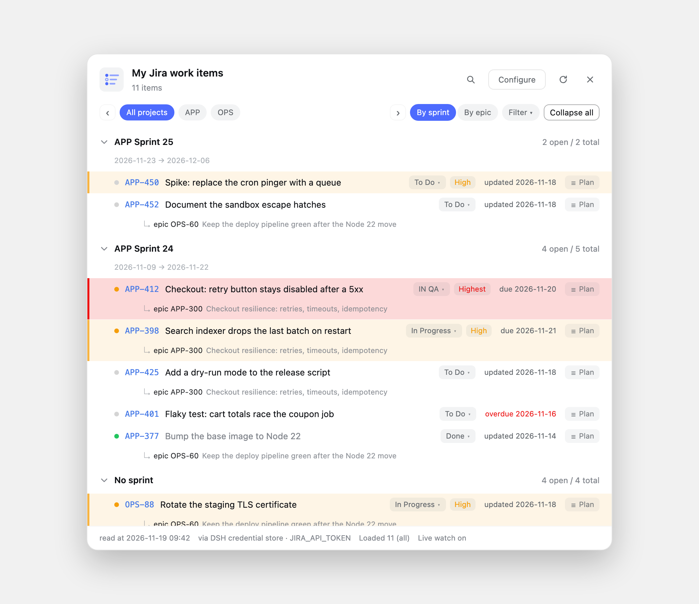
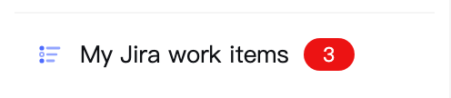
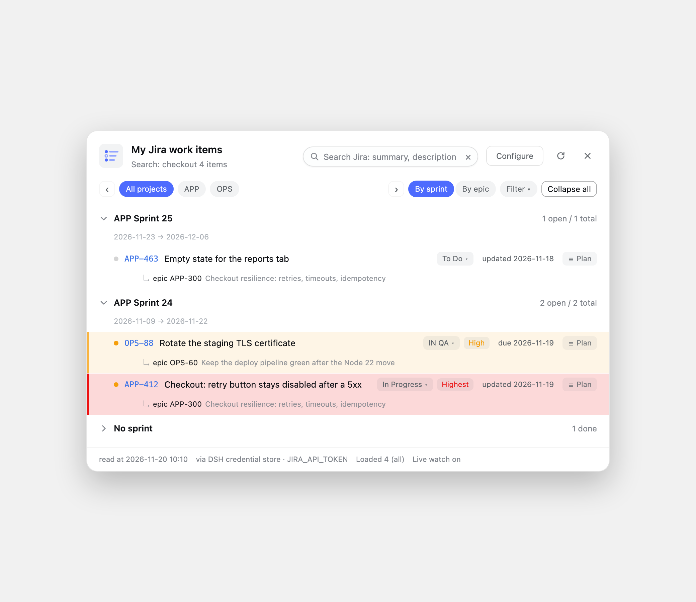
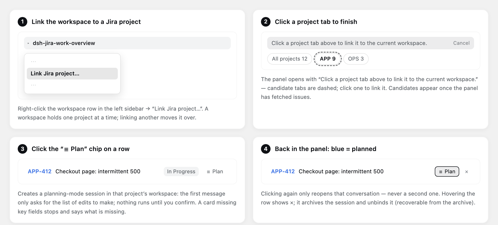
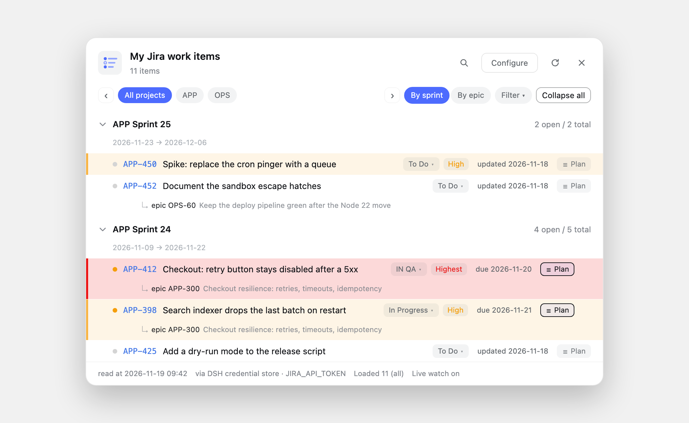
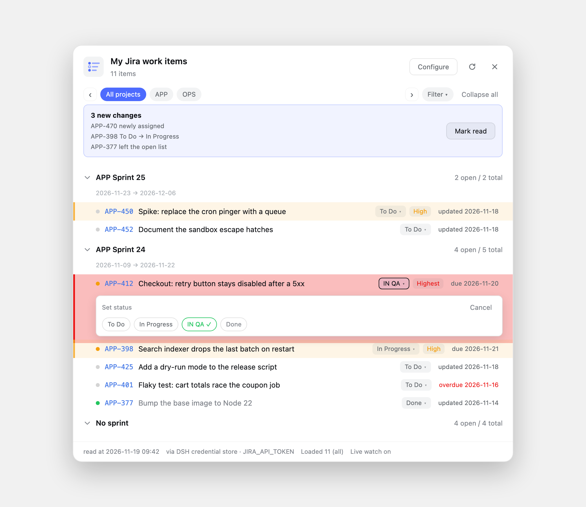
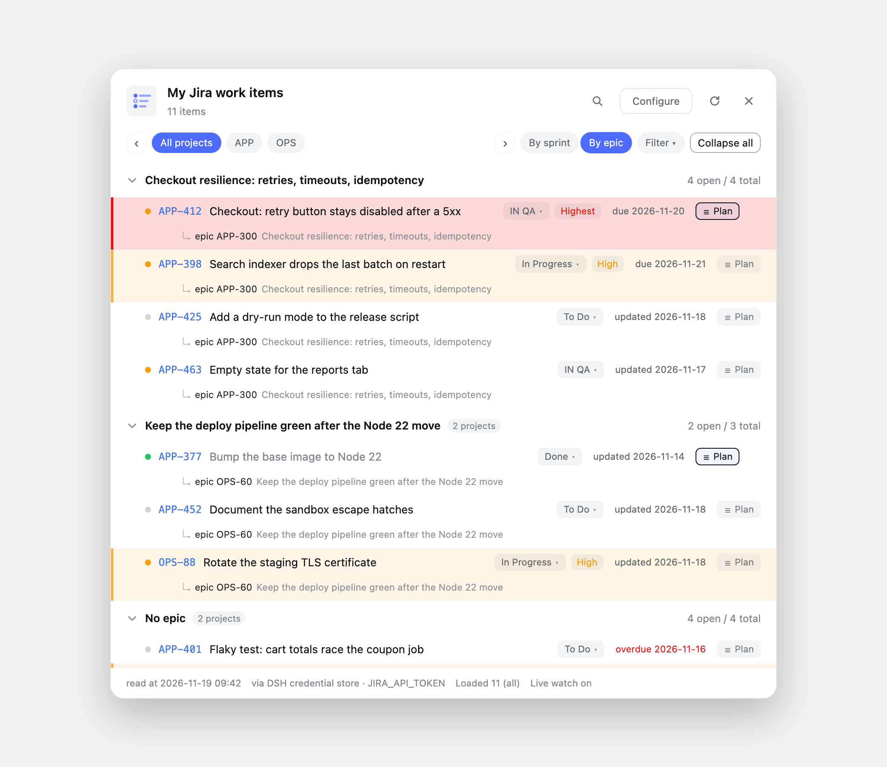

# dsh-jira-work-overview

Show **your** Jira work items — with their real workflow status — inside [DeepSeek Harness](https://github.com/deepseek-ai) (DSH): as agent tools, as a `/jira` slash command, and as a panel in the left sidebar with a live unread badge.

[](https://github.com/EagleSoap/dsh-jira-work-overview/actions/workflows/test.yml) [](https://github.com/EagleSoap/dsh-jira-work-overview/actions/workflows/release-check.yml)

> 中文说明见 [README.zh.md](README.zh.md) · Changelog: [CHANGELOG.md](CHANGELOG.md) · License: [MIT](LICENSE)

<p align="center">
  
</p>

---

## What you get

- **Rows are highlighted by Jira's own priority order** — the top two levels get a row background and a left bar (reddest = highest), read from `GET /rest/api/3/priority` rather than a hard-coded "Highest", so a site that reorders priorities or uses custom names (`P0`, `Blocker`) still gets it right. Everything below stays uncoloured. If the site does not expose that list, the panel falls back to matching the names `Highest` / `High`.
- **Left-sidebar panel** — one row per issue, grouped by sprint (collapsible, newest sprint first), with project tabs, a single-select **status filter**, an **accurate total** in the header, priority highlighting (see above), and a status dropdown to move an issue through its workflow **in place** — only that row and the counts are updated, the list is not re-fetched.
- **Epic / parent relations, without a canvas** — every row carries its place in Jira's own hierarchy: a `↳ epic APP-123 · <title>` line (or `↳ parent APP-123` for sub-tasks without an epic), clickable to jump to that issue. A **按迭代 / 按 epic** switch in the header re-groups the same list by Epic Link instead of sprint, and a group that spans several projects is labelled with its project count — so "which epic is this across projects" is one glance, with no free-form graph to maintain. Both views share the same virtualization, collapse state and totals; a site without an epic field silently falls back to the "no epic" group, and rows without any relation take no extra height.
- **Search, Jira-style** — the magnifier in the panel header opens a search row. Enter searches **all of Jira** (summary / description / comments, via Jira's own `text ~` operator), not just your issues; an issue key or a pasted `/browse/APP-123` link jumps straight to that issue. Results reuse the same sprint grouping, project tabs, status filter and accurate total, so a hit shows which sprint it belongs to; `×` clears back to your work.
- **Live watch** — the host polls "assigned to me and not done" in the background; new assignments / status changes show a **system notification**, an **unread badge** on the sidebar entry, and a "what changed" banner with *mark as read*. The panel refreshes itself when a change arrives.
- **Three agent tools** — `jira_my_work`, `jira_issue`, `jira_transition` (preview by default, writes only with `apply: true`).
- **One slash command** — `/jira [--json] [--limit=<n>|0] [--lang=<tag>] [--search=<text>] [open|sprint|all | <issue key> | <JQL>]`; it renders in the command surface, so it costs no model tokens.
- **First run is the form** — with no Jira site, email or token the panel body *is* a **Connect Jira** form (site URL, email, API token) in the exact spot the failure message used to take; fill what is missing and press **Save and connect**. Already-saved fields can be left empty, and **Configure** is still one click away for fetch size, watch, notifications and language.
- **Configure dialog** — Jira site / email / API token (token goes to the DSH credential store), fetch size, watch switch + interval, notification switch, UI language, and one-click **open `cordis.patch.yml`** (default app / system "open with" chooser / detected editors / custom app).
- **Bilingual UI** — follows the DSH language setting (`设置 → 通用 → 语言`), live; Jira-returned text (summaries, status names, labels) is always shown verbatim.

## Requirements

| | |
| --- | --- |
| DSH | Desktop app or `dsh web`, with the plugin manager (`plugin_manager`) available |
| Jira | Cloud or Server, plus an **API token** for your own account and your login email |
| Build step | none — the package ships `index.js` (host half) and `client.js` (web half) as-is |

## Install

DSH installs plugins from an **installation spec** — anything `pnpm add` accepts (registry package name, git URL, tarball, absolute path). Pick one:

```bash
# 1) from the npm registry (published since 0.14.0; pin a version with @0.16.0)
plugin_manager install_bundle(target="dsh-jira-work-overview")

# 2) straight from GitHub (no npm publishing needed)
plugin_manager install_bundle(target="github:EagleSoap/dsh-jira-work-overview")

# 3) from a local checkout
plugin_manager install_bundle(target="/absolute/path/to/dsh-jira-work-overview")
```

Or do it in the UI: left icon rail → **Plugins** → install, and paste the same spec.

Installing adds `dsh-jira-work-overview` to your profile's bundle list and inserts the plugin row declared in `cordis.patch.yml`. The host then serves the web half as a plugin bundle — **refresh the page** (Cmd/Ctrl+R) and the sidebar entry appears.



## First-run configuration

The bundled `cordis.patch.yml` deliberately contains **no site-specific values**, so nothing of the author's Jira account is shipped. Open the panel, click **配置 / Configure** in the panel header, and fill in:

| Field | Example | Required |
| --- | --- | --- |
| Jira site URL (`baseUrl`) | `https://your-site.atlassian.net` | ✅ — the tools tell you when it is missing |
| Login email (`email`) | `you@example.com` | ✅ (Basic auth = email + token) |
| API token | create one at [id.atlassian.com → API tokens](https://id.atlassian.com/manage-profile/security/api-tokens) | ✅ |
| Project key / board id | `APP` / `42` | optional, used for labels and the sprint field |
| Fetch size (`maxResults`) | `0` = unlimited | optional |
| Watch switch / interval, notifications, UI language | — | optional (change = save) |

The token is written to the **DSH credential store** (key `JIRA_API_TOKEN` unless you change `credentialKey`); it never enters the repo, the logs, or the UI (the panel only shows a masked form such as `ATAT…0000`). Before storing, the plugin verifies the email + token pair against `/rest/api/3/myself` and refuses to save a rejected token.

Prefer files? Add an override row to your profile's `cordis.patch.yml` (this is also where the panel writes the ✏️ fields):

```yaml
- id: jira-work-overview
  config:
    baseUrl: https://your-site.atlassian.net
    email: you@example.com
    projectKey: YOURKEY
    boardId: 42
```

## Usage

### Panel

- **Project tabs** (with `‹ ›` scrolling) filter by issue-key prefix; **status filter** is single-select, defaults to "all statuses".
- **Search**: the header magnifier expands in place into a field that slides out to the left; type a keyword or an issue key and press **Enter**. The query runs against all of Jira (not only your issues); matches are grouped by sprint like your own list, with the same project tabs / status filter / total. Losing focus (or **Esc**) collapses the field back to the button and keeps an unsubmitted draft; a submitted query clears the field and keeps the results, and `×` clears the search to return to your work.

  
- The header shows the **accurate total** for the current project + status, straight from Jira's `approximate-count`.
- Click a **status chip** on any row to move the issue; the list reloads. **Esc** closes the top-most layer (status menu → configure dialog → panel).
- The list is **virtualized**: thousands of rows scroll smoothly because only the visible ones are in the DOM.
- **Plan at the end of a row** (the `☰ 计划` chip) opens a *planning* conversation for that issue in the
  workspace the project is linked to: the new session switches to plan mode, receives the issue key, title, status and link, and is told
  to report **only the list of changes it intends to make** — no explanations, no analysis. You approve or amend
  the plan in that conversation, and nothing is executed before you do. If the issue is too thin to plan (no
  description, no parent and no links), the session stops instead of guessing and tells you the Jira issue is
  unclear. One issue maps to one planning session: once bound the chip is highlighted, clicking it reopens the
  existing conversation (the binding lives in the volatile `planSessions` config as `ISSUE<TAB>sessionId`, and a
  lost binding is recovered from the `JIRA_PLAN_SESSION:<KEY>` marker in the session's first message). The button
  reports what is missing when the project has no linked workspace; if the profile ships
  `deepseek-ai/dsh-plan-mode`, its `section` is the planning policy, and without it the first message carries a
  built-in one ("plan only, list the changes, execute once the user agrees").
  A planned row also carries a `×`: it archives that conversation through DSH's own workspace archive
  (`remote.workspace.archiveSession`, same path as the sidebar's *Archive`) and clears the binding, so the row is
  unplanned again and the next click starts a fresh session. Archiving keeps the log — a mis-click is
  recoverable from the archive.

### Planning: link a workspace, then plan

The `☰ Plan` chip needs the project to be linked to a workspace first — that is the step first-time users
miss. Four steps, and from then on every card is one click away from a planning conversation:



1. **Link the workspace to a project**: right-click the workspace row in the left sidebar → *Link Jira project…*.
   A workspace holds one project at a time; linking another one moves it over, and the menu item becomes
   *Unlink Jira project* once something is linked.
2. **Click a project tab**: the panel opens by itself and the header reads "Click a project tab above to link it
   to the current workspace." Candidate tabs carry a **dashed** outline — click one to link it; the header then
   reads "This workspace is linked to APP". Candidates appear only after the panel has fetched issues once, so
   hit *Refresh* if there are none.
3. **Click the `☰ Plan` chip at the end of a row**: creates a planning-mode session in that project's workspace.
   The first message only asks for a bullet list of the edits to make, and you agree to it in the conversation.
   `deepseek-ai/dsh-plan-mode` is optional — a built-in policy is used when it is absent.
4. **Back in the panel**: the chip turns blue (`on`) = planned. Hovering the row reveals a `×` that archives the
   session and clears the binding (recoverable from the archive).

The real panel, for comparison (the two planned rows near the top are outlined):



#### "Plan" does nothing or shows an error

| What you see | Why | What to do |
| --- | --- | --- |
| `Project APP is not linked to a workspace: link it from the sidebar first.` | The project is not linked to any workspace (or the mapping was lost) | Redo steps 1–2 above |
| No candidate tabs / `No projects to link yet: open the panel once so the project list loads.` | The panel has never fetched issues successfully | Hit *Refresh*; if it still fails, set the site / email / token first |
| The workspace context menu has no *Link Jira project…* | The client half of the plugin did not register (the host row can still read active) | Reinstall the bundle and reload the page |
| The chip stays grey and does nothing | The previous session creation has not returned yet | Wait for it; a failure shows `Could not create the planning session: …` |
| It always reopens the same conversation | One issue maps to one planning session (by design) | Click `×` to archive it, then click *Plan* again |
| The first message says the Jira issue is unclear | The card is missing key fields: no summary / description / parent or links | Fill those in on Jira and click *Plan* again |



### Epic view

The **By sprint / By epic** switch in the header re-groups the same list. Each group is an Epic Link (or "No epic"), a group that spans several projects is labelled with its project count, and every row keeps its `↳ epic APP-123` line — one level of Jira's own hierarchy, no free-form graph to maintain.



### Slash command

```
/jira                       # my open items, text
/jira --json                # same, as JSON (used by the panel)
/jira --limit=200           # cap this call (0 = unlimited)
/jira --status="IN QA"      # server-side status filter
/jira --search="login error" # full-text search across all of Jira (or an issue key)
/jira APP-4051              # one issue in full
/jira project = APP AND duedate is not EMPTY
```

### Agent tools

| Tool | Purpose |
| --- | --- |
| `jira_my_work` | my issues + status, grouped; `scope` = `open` / `sprint` / `all`, or your own `jql`; `status` filter; `limit` |
| `jira_issue` | one issue in full: fields, description (ADF → plain text), optional recent comments |
| `jira_transition` | list the workflow transitions of an issue, or apply one (`apply: true`) — preview by default |

### Live watch and notifications

The host polls `assignee = currentUser() AND statusCategory != Done` every `watchIntervalMs` (default 60 s, minimum 15 s). New assignments and status changes notify; items that simply leave the open list are recorded but stay silent. The first poll only establishes a baseline.

A status **you** changed — from the panel dropdown or `jira_transition` — is not news: the write records the expected `from → to` and the next poll silently advances its baseline instead of raising a notification, an unread badge or a banner entry. The match is on that exact pair, so a colleague changing the same issue to something else still notifies. Notifications use `osascript` on macOS, a PowerShell Toast on Windows, and `notify-send` elsewhere — silently degrading if the platform refuses.

## Configuration reference

| Key | Default | Meaning |
| --- | --- | --- |
| `baseUrl` | `''` | Jira site root, e.g. `https://your-site.atlassian.net` (**required**) |
| `email` ✏️ | `''` | login email used for Basic auth |
| `apiToken` | `''` | fallback only — prefer the DSH credential store |
| `credentialKey` | `JIRA_API_TOKEN` | credential-store key that holds the token |
| `projectKey` | `''` | optional project label |
| `boardId` | — | agile board id, used to read the active sprint |
| `maxResults` ✏️ | `0` | fetch cap: `0` = unlimited, otherwise 10–5000 (safety net: 5000 items / 50 pages / one `timeoutMs` budget) |
| `timeoutMs` | `30000` | HTTP timeout, and the total budget for one paged fetch |
| `watchEnabled` ✏️ | `true` | background watch on/off |
| `watchIntervalMs` ✏️ | `60000` | watch interval (≥ 15000) |
| `notify` ✏️ | `true` | desktop notifications on changes |
| `language` ✏️ | `auto` | UI/tool language: `auto` / `zh` / `en` |
| `preferredEditor` ✏️ | `''` | last editor used for "open `cordis.patch.yml`" |

✏️ = runtime-editable: the panel writes it through the host `settings` service into the **active profile's `cordis.patch.yml`**, and it applies immediately (no restart).

## Platform support

| | macOS | Windows | Linux |
| --- | --- | --- | --- |
| Notifications | `osascript` | PowerShell Toast (`-EncodedCommand`); the AUMID is tried in order `DSH_NOTIFY_AUMID` → `DeepSeek Harness` → PowerShell's own AUMID | `notify-send` |
| Open `cordis.patch.yml` | `open` / `open -R` / osascript app chooser | `cmd /c start` / `rundll32 … OpenAs_RunDLL` / `explorer /select,` | `xdg-open` |
| Editor picker | scans `/Applications`, `~/Applications`, `/System/Applications` for `.app` bundles | `where` + `%LOCALAPPDATA%` / `%ProgramFiles%`; `PATH` split on `;` | searches `PATH` **plus** the usual install locations (`/usr/local/bin`, `/snap/bin`, flatpak exports, `~/.local/bin`, `~/.nix-profile/bin`, JetBrains Toolbox), requires an executable bit, launches the resolved absolute path |
| Host paths | POSIX | avoid spaces in the install path — DSH records it as a `link:` dependency | POSIX |

The web half only uses standard React/DOM APIs (`color-mix`, `createPortal` are supported on all three).

The `cordis.patch.yml` path may be POSIX (`/…`), a Windows drive path (`C:\…` / `C:/…`) or a UNC share
(`\\server\share\…`, the case when a corporate profile is redirected to a network location).

Known edge: on Windows the `cmd /c start` fallback re-interprets `cmd` metacharacters (`&`, `%`) if the path
contains them — profile paths placed by DSH do not. `explorer.exe /select,` returns 1 even on success, so only a
failure to spawn is reported as an error.

**What is real and what is not, on Linux:** every platform difference — notifications, opening `cordis.patch.yml`,
the editor picker and its `PATH` lookup, fonts and scrollbars — is implemented by `process.platform` dispatch and
covered by the offline suites, **but it has never been run on a Linux machine** (development happens on macOS). If
something misbehaves there, open an issue with the panel's error text. The one Linux-specific gap by design:
the "choose application" picker has no desktop-portal equivalent, so only `xdg-open` / the editor picker / a
freely typed command are offered.

## Internationalization

The plugin's own copy follows the DSH language setting; English and Chinese ship with the plugin and every other language falls back to English. Resolution order: `DSH_JIRA_LANG` → per-call override (`--lang=` / `?lang=`) → `language` config → the host `locale.preference` → the panel-reported language → system env → ICU → `en`. Jira data is never translated.

## Troubleshooting

| Symptom | Meaning |
| --- | --- |
| `Cannot reach https://… (…): ECONNRESET` / `HTTP 000` | your machine cannot reach Jira right now (VPN/proxy/network), not a plugin bug |
| "No matching work items" with no error row | the query returned nothing — widen the status filter or the project tab |
| footer says "live watch unavailable" | the Electron shell did not expose a fetch transport; the panel/badge degrade, tools still work |
| configure dialog says "Reading the token state failed: HTTP 404" | the plugin's `/api` routes were not registered (the host loaded the plugin before its connection service existed) — reload the plugin; a fixed build registers them once the service is up |
| footer says "live watch disconnected" | transient transport error; it retries with backoff |
| token rejected when saving | the email + token pair is wrong, or the token has no Jira access |
| panel body is a **Connect Jira** form | nothing is configured yet: fill site URL / email / API token and press **Save and connect** (a saved field can stay empty); the form sits where the failure hint used to be, and the token still goes straight to the DSH credential store |
| panel says "Jira rejected this email / token pair" | 401/403 from Jira: regenerate the token; the raw response is under the hint |
| panel says "Could not read the stored token" | the credential store returned an error rather than a value: save the token again from **Configure** |

Behind a corporate proxy on Windows, DSH needs the proxy env vars it was started with (`NODE_USE_ENV_PROXY=1`) — the plugin itself never talks to the network outside `fetch`.

## Versions and upgrades

The current version is **0.16.0** (2026-11-20). The changelog records 30 versions (from 0.1.0); GitHub carries **9 tags / releases** (0.13.0 → 0.16.0), and **0.13.4 was the first public release** — the earlier 0.1.0–0.12.0 exist only in `CHANGELOG.md` and the project notes, with no commit or tag behind them, so "an older version" means **0.13.0 or later**. Every release is described in [CHANGELOG.md](CHANGELOG.md).

### Why people still install older versions

- **The package was not on npm before 0.14.0.** Until then the only ways in were a GitHub URL or a local path — `plugin_manager install_bundle(target="dsh-jira-work-overview")` simply could not resolve. And an existing install never upgrades itself: whichever spec you installed stays pinned.
- **0.13.0 / 0.13.1 never loaded their browser half** (see below): the sidebar entry, the panel and the token configuration were all missing, while `plugin_manager` still showed `fiberPhase: "active"` — easy to read as "the plugin is broken". Upgrade to 0.13.2+.
- **0.15.0 and earlier report "Reading the token state failed: HTTP 404"** in the configure dialog, and the badge, the status dropdown and the watch form fail with it (one root cause). Fixed in 0.15.1; upgrading from 0.15.1 on **keeps your email / token**.

### Version history

| Version | Date | Kind | In one line |
| --- | --- | --- | --- |
| 0.1.0 | 2026-11-18 | first | `jira_my_work` / `jira_issue` tools, the `Config` card, token from the credential store |
| 0.2.0 | 2026-11-18 | feature | `/jira` slash command (no model message, no tokens), scope / issue key / raw JQL |
| 0.3.0 | 2026-11-18 | feature | the **client panel** in the left sidebar, fed by `ctx.remote.commands.execute('/jira --json')` |
| 0.4.0 | 2026-11-18 | feature | **sprint** grouping (collapsible), sprint field resolved via `schema.custom` |
| 0.5.0 | 2026-11-18 | feature | **live watch**: background polling, system notifications, unread badge, "what changed" banner |
| 0.6.0 | 2026-11-18 | feature | **status transitions** from the panel + the `jira_transition` tool |
| 0.7.0 | 2026-11-18 | feature | High / Highest row highlighting |
| 0.7.1–0.7.3 | 2026-11-18 | fix / trim | drop the unreliable "active sprint" line; abort the previous request on switch |
| 0.8.0 | 2026-11-18 | feature | **API token** editable in the plugin's own config page (masked, `/myself` check, rejected pairs never stored) |
| 0.8.1–0.8.6 | 2026-11-18 | feature | several config entry points, token modal, watch switch → **applies as you change it**, **project tabs** |
| 0.8.7–0.8.10 | 2026-11-18 | feature | editable login email, **Windows / Linux support**, UI language, configurable fetch size |
| 0.9.0 | 2026-11-18 | feature | **internationalization** (zh / en dictionaries following the DSH language) |
| 0.10.0 | 2026-11-18 | feature | accurate totals (`projectTotals`), editor picker; JQL conditions inserted before `ORDER BY` |
| 0.11.0 | 2026-11-18 | feature | single-select **status filter** (server-side `--status`), accurate total from `approximate-count` |
| 0.12.0 | 2026-11-18 | feature | **virtualized list** (`@tanstack/react-virtual`), `maxResults: 0` = unlimited |
| 0.13.0 | 2026-11-18 | release prep | package renamed `dsh-jira-work-overview`, MIT, neutral defaults only in `cordis.patch.yml` |
| 0.13.1 | 2026-11-18 | cleanup | removed three stale test suites |
| 0.13.2 | 2026-11-18 | **fix** | the browser half never loaded (bundle id ≠ package name) |
| 0.13.3 | 2026-11-18 | fix | group headers overlapped after "collapse all"; scrolling flashed the macOS screen |
| 0.13.4 | 2026-11-18 | **first public** | desensitized: no personal values left in the repo, the docs or the git history |
| 0.14.0 | 2026-11-19 | feature | highlight follows **Jira's own priority order**; **first npm release** |
| 0.15.0 | 2026-11-19 | feature | transitions update **in place**, your own changes no longer notify you, typed failure hints |
| 0.15.1 | 2026-11-19 | **fix** | the four `/api` routes were never registered in a real host (404) |
| 0.16.4 | 2026-11-23 | **fix** | on a fresh profile, filling email + token + site URL and clicking only **Save & verify** left the URL unsaved, so the panel always said there was no site URL; the panel now also reloads automatically after a successful save |
| 0.16.3 | 2026-11-23 | **fix** | the Jira site URL is now an editable field in the config page (placeholder = current URL, saved to the profile Cordis patch); the failure hint's **Configure** button matches **Save and verify** |
| 0.16.2 | 2026-11-23 | **fix** | the workspace context menu's **Link Jira project…** could vanish for a whole page (client startup race); covered by a new offline suite |
| 0.16.1 | 2026-11-22 | fix | Windows notifications and *Show in file manager*, the Linux editor picker, UNC patch paths; three-OS CI and the release preflight; a planning walkthrough in both READMEs |
| 0.16.0 | 2026-11-20 | feature | **site-wide search**, **group by epic**, the **计划** (plan) button on every row |

> 0.1.0–0.12.0 all happened on 2026-11-18; tags and GitHub Releases start at 0.13.0.
> To install an older version: `plugin_manager install_bundle(target="github:EagleSoap/dsh-jira-work-overview#v0.13.2")`, or pin the npm version with `target="dsh-jira-work-overview@0.14.0"` (the earliest version on npm is 0.14.0).

### Upgrading

There is no "check for updates" button — upgrading means reinstalling the same spec:

```bash
plugin_manager install_bundle(target="dsh-jira-work-overview")  # resolves the newest release when already installed
```

then **refresh the DSH page** (Cmd/Ctrl+R). Upgrading never touches your profile patch or the token in the credential store; since 0.13.0 `cordis.patch.yml` ships neutral defaults only, and your personal values (site / email / project key / board id) always live in your own profile.

## Fixed issues

Every user-visible defect, newest first (implementation detail is in the matching [CHANGELOG.md](CHANGELOG.md) entry).

| Version | Symptom | Cause / fix |
| --- | --- | --- |
| 0.16.2 | The workspace right-click menu lost **Link Jira project…** (so there was no way to bind a project), while the panel itself kept working | Browser-side plugins are created concurrently, and this one only waits for `slots` / `remote`; `contextMenus` waits for `locale` / `shortcuts` too, so a single `ctx.get('contextMenus')` in `apply()` could see it missing and skip the registration for the whole page. It now registers through `ctx.inject(['contextMenus'], …)` once the service appears; an older host without `ctx.inject` falls back to the direct path |
| 0.16.1 | On Windows, new assignments and status changes produced **no notification at all** | A Windows toast must be posted under a **registered** AUMID; an unregistered one makes `CreateToastNotifier()` throw `Element not found (0x80070490)`, which was swallowed. It now tries `DSH_NOTIFY_AUMID` → `DeepSeek Harness` → `com.deepseek.harness` → the built-in PowerShell AUMID in order; the script statements are joined with newlines (`{; try … }` is a PowerShell syntax error, so nothing ran) |
| 0.16.1 | On Windows, *Show in file manager* opened Explorer but still reported a failure | `explorer.exe /select,` exits with code 1 even on success. That branch now tolerates a non-zero exit; only a process that never starts counts as a failure |
| 0.16.1 | With the profile on a network share, the config file was treated as an unknown path | Absolute-path detection only accepted `/…` and `C:\…`. It now also accepts UNC paths (`\\server\share\…`) |
| 0.16.1 | On Linux the editor picker "did nothing" and launches from a desktop launcher failed | Only the command name was stored, and a desktop session has a minimal `PATH`. Detection now covers `PATH` plus `/usr/local/bin`, `/usr/bin`, `/snap/bin`, flatpak exports, `~/.local/bin` and friends (executables only), and launch always uses the absolute path |
| 0.16.1 | A fresh clone crashed the test suite: `ENOENT … .dsh_jira_env`; without site credentials the `transition` suite exited 1 | A missing env file is created empty (`mkdirSync` first when the directory is missing), and missing credentials now print `SKIP: …` and `exit 0` — suites skip, they do not fail |
| 0.16.0 | `×` fails with `归档计划对话失败：no workspaces service` / `这个 profile 没有提供工作区归档通道` | wrong facade: `ctx.get('workspaces')` is empty (the registry is `workspaceRegistry`) and the remote namespace is `workspace`, not `workspaces`. Now tries `remote.workspace.archiveSession` → the workspace registry itself → `connection.call('workspace/archiveSession')` |
| 0.16.0 | after deleting a plan session, 计划 reopens the archived one | the panel now fetches the binding with `force: true` (mapping only, no log scan) and the fresh-create path passes `skipToken: true` |
| 0.16.0 | 计划 throws `cannot get property "remote.session" without inject` | now uses the base's `sessions.create({ workspaceId })` + `sessions.using(id, …)` — the same path as the chat box |
| 0.16.0 | 计划 errors out when no plan-mode plugin is installed | policy resolved from settings → the panel's host config view → the profile row in the boot data, with a built-in fallback in the first message |
| 0.16.0 | the epic view only ever shows the "no epic" group | a site can expose both `gh-epic-label` (always empty) and `gh-epic-link` (carries the key); an array-order `find` picked the empty one. Now resolved by schema priority (link first) |
| 0.15.1 | "Reading the token state failed: HTTP 404", and the badge, status dropdown and watch form with it | the plugin read `ctx.get('connection')` synchronously in `apply()` while `client-connection`'s `apply` is async, so the same load batch got `undefined` — the four exact `/api` Fetch routes were **never registered**. Now `ctx.inject(['connection'], …)`; the offline stub mirrors real host timing |
| 0.15.0 | a transition re-fetched hundreds of rows; your own change notified you again | the row + counts are updated in place; an expectation (key → from / to / category, 24h TTL) written around the POST absorbs the matching poll diff |
| 0.15.0 | the panel pasted raw errors with no way forward | `--json` failures return `ok:false` + `error.code` (`no_credential` / `credential_unreadable` / `no_email` / `no_base_url` / `auth` / `network` / `http` / `not_json` / `unknown`); the panel shows a title plus **Configure** / **Retry** |
| 0.13.4 | the author's real project key and token fragments appeared in docs, screenshots and tests | replaced with the made-up `APP` / `ATAT…0000`; `projectKey` defaults to `''`; tests derive their own path; the **git history was rewritten** (old SHAs are void) |
| 0.13.3 | after "collapse all", a group header's title and date overlapped | `@tanstack/react-virtual`'s default `getItemKey` is `index => index`, so heights are cached by index; now keyed by identity (`g:<group id>` / `i:<issue key>`) and `estimateSize` estimates per kind (header 64 / row 32) |
| 0.13.3 | scrolling the list flashed the whole macOS screen | a full-window `backdrop-filter: blur(2px)` flashes on scroll repaint in Electron; the masks now dim without blurring |
| 0.13.2 | after installing, the sidebar entry, the panel and every token config page were **missing**, yet `plugin_manager` said `active` | `client.js` still registered the old `@local/…` bundle id, so the host's client boot graph could not match it; `test/dsh-jira-bundle-id.mjs` pins the three names together |
| 0.13.1 | three test suites had been red for a while | they predated the 0.7 panel redesign and are covered by `dsh-jira-visual.mjs` / `dsh-jira-credential.mjs`; deleted |
| 0.13.0 | a missing site only said "no base URL" | `err.noBaseUrl` now says where to set it |
| 0.12.0 | not all items were fetched / the page got slow | virtualization + `maxResults: 0` pages to the end; safety net 5000 items / 50 pages / one `timeoutMs` budget, partial results honestly carry `hasMore: true` |
| 0.11.0 | "N items" disagreed with what was on screen | the header now uses Jira's `approximate-count`; `--status` is applied server-side so the list and the count cannot disagree |
| 0.10.0 | adding a status condition produced invalid JQL and a silently empty `projectTotals` | conditions must be inserted **before** `ORDER BY` (appending after it is HTTP 400); now through `withJqlClause` |
| 0.9.0 | the UI language ignored the DSH language setting | resolved `DSH_JIRA_LANG` → per-call → config → host `locale.preference` → the panel's reported language → system env → ICU → `en` |
| 0.8.8 | editing the email had no effect | it read the startup snapshot; now read through `liveSetting()` per operation |
| 0.8.7 | a wrong email meant editing `cordis.patch.yml` | editable in the dialog, verified against `/rest/api/3/myself` as a pair with the token |
| 0.8.6 | the test predicate matched `jmw-rowmeta` as a row | tightened to an exact class match |
| 0.8.4–0.8.5 | the dialog was not centred / white on white in the dark theme / overlays survived closing the panel | restored the classes a CSS rewrite had dropped; button colours are hardcoded (`--dsw-alias-brand-primary` is near-white in the dark theme); `closeAll()` moved into the shared snapshot |
| 0.8.0–0.8.3 | the token was file-only; settings needed a restart | the token moved into the plugin config page; watch settings use `.volatile()` + `settings.mutate` and apply on `loader/volatile-update` |
| 0.7.3 | a fast project / status switch let a stale response win | the previous request is aborted and a sequence number discards stale responses |
| 0.7.1 | the tool output's "active sprint" did not match reality | the board's sprint state is not reliable; the line is gone |
| 0.1.0–0.6.0 | early gaps | see the matching `CHANGELOG.md` entries |

### Where to start

1. **No sidebar entry**, or `plugin_manager` says `active` while the UI is empty → upgrade to **0.13.2 or later** and refresh.
2. The configure dialog reports **HTTP 404** / the badge never updates → upgrade to **0.15.1 or later**.
3. **Nothing is configured yet** → the panel body is a **Connect Jira** form (site URL, email, API token); fill what is missing and press **Save and connect**. A rejected token / unreadable credential keeps the failure hint: use **Configure** there (or at the right of the panel title); you never have to edit the profile file.
4. A raw error from `/jira` in text mode is **on purpose** — the command surface should show the real reason; the panel uses the typed `--json` hints instead.

## Security and privacy

- The API token lives in the **DSH credential store**; the plugin only ever returns a masked form + its source, never the value. There is no place in the code where a full token is logged or rendered.
- The plugin reads **only issues assigned to you** (the JQL always starts from `assignee = currentUser()`) and writes **only** the workflow transition you click, plus your own settings.
- Your Jira site / email are personal configuration: they belong in your profile (`cordis.patch.yml` / the panel), **not** in this repository.

## Development

```
dsh-jira-work-overview/
├── index.js          host half: tools, /jira command, fetch routes, watch loop, Jira client
├── client.js         web half: sidebar entry, panel, configure dialog (plain React via __ModuleLoader__)
├── cordis.patch.yml  the plugin row this bundle inserts (neutral defaults only)
├── locale/{zh,en}.json  plugin-list title/description (file name = language id, en.json required)
├── icon.svg          plugin-list icon (36×36, transparent, theme-friendly strokes)
├── docs/images/      README screenshots, rendered by `test/dsh-jira-shot.mjs`
└── test/             offline + real-Jira suites
```

Tests run under DSH's own Electron-as-Node binary (`ELECTRON_RUN_AS_NODE=1`):

```bash
BIN="/Applications/DeepSeek Harness.app/Contents/MacOS/DeepSeek Harness"
ELECTRON_RUN_AS_NODE=1 "$BIN" test/dsh-jira-visual.mjs      # offline: rendering, virtualization, filters
ELECTRON_RUN_AS_NODE=1 "$BIN" test/dsh-jira-credential.mjs  # offline: config panel, routes, paging
ELECTRON_RUN_AS_NODE=1 "$BIN" test/dsh-jira-i18n.mjs        # offline: language matrix + dict parity
ELECTRON_RUN_AS_NODE=1 "$BIN" test/dsh-jira-transition.mjs  # real Jira (read-only + failure paths)
ELECTRON_RUN_AS_NODE=1 "$BIN" test/dsh-jira-status.mjs      # real Jira (skips itself when unreachable)
ELECTRON_RUN_AS_NODE=1 "$BIN" test/dsh-jira-shot.mjs        # regenerate docs/images (headless Chrome, fake data)
```

The screenshots are generated offline too: `test/dsh-jira-shot.mjs` renders the real `client.js` components with the real plugin CSS and a fixed set of **made-up** APP/OPS issues, serializes them to static HTML and lets headless Chrome shoot them — so the images never contain a real site, account or issue. Run it with `--lang en,zh`, `--theme dark`, `--only panel|panel-plan|panel-watch|panel-search|panel-epic|sidebar-entry` or `--out <dir>`; it prints `SKIP:` and exits 0 when no Chrome is installed.

The host half imports `@deepseek-ai/schemastery`, which only resolves inside the app, so the suites copy `index.js` next to a copy of that dependency in a temp dir (`DSH_JIRA_TMP` overrides the location). Real-Jira suites read a token from `DSH_JIRA_ENV_FILE` (default `$TMP/.dsh_jira_env`, `chmod 600`) and **skip** when Jira is unreachable instead of reporting a false regression.

## License

[MIT](LICENSE) © 2026 Zhaohong Fei
