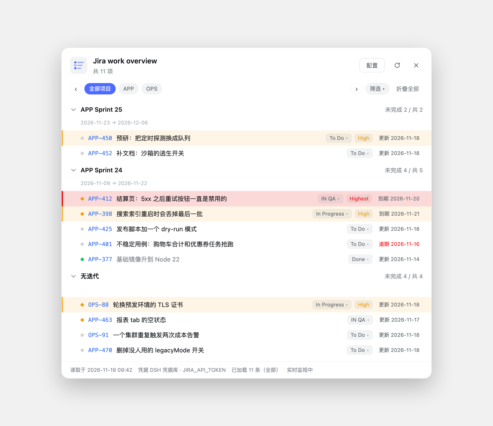
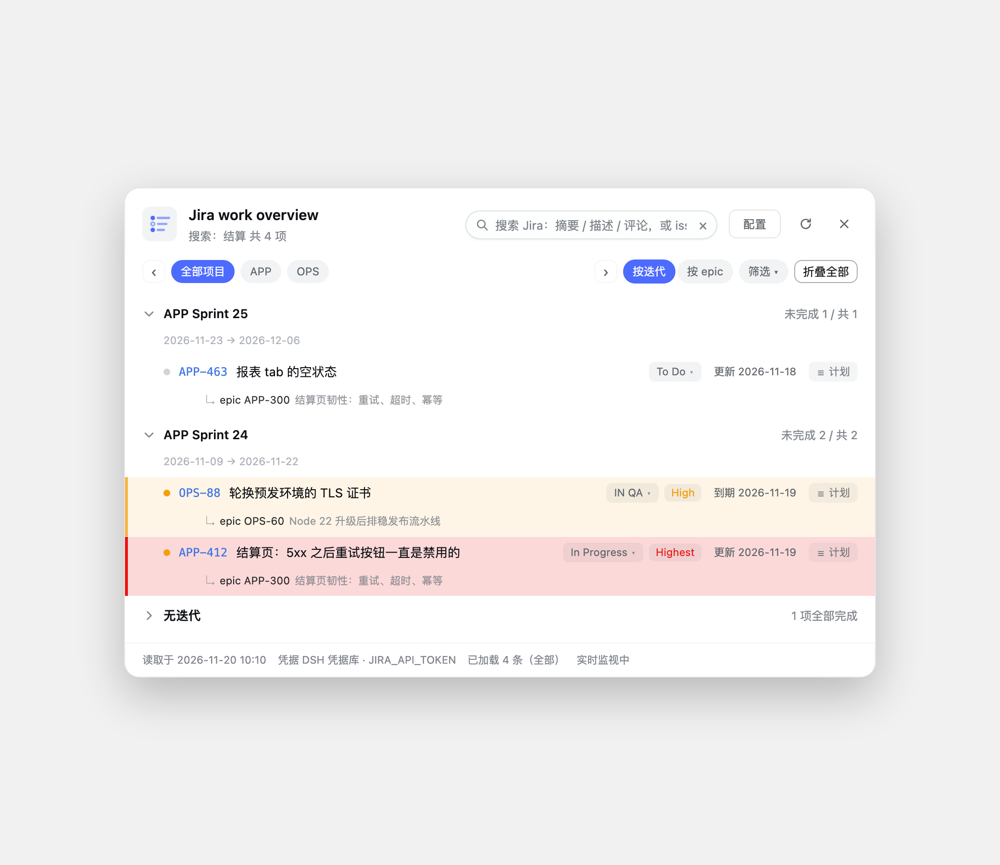
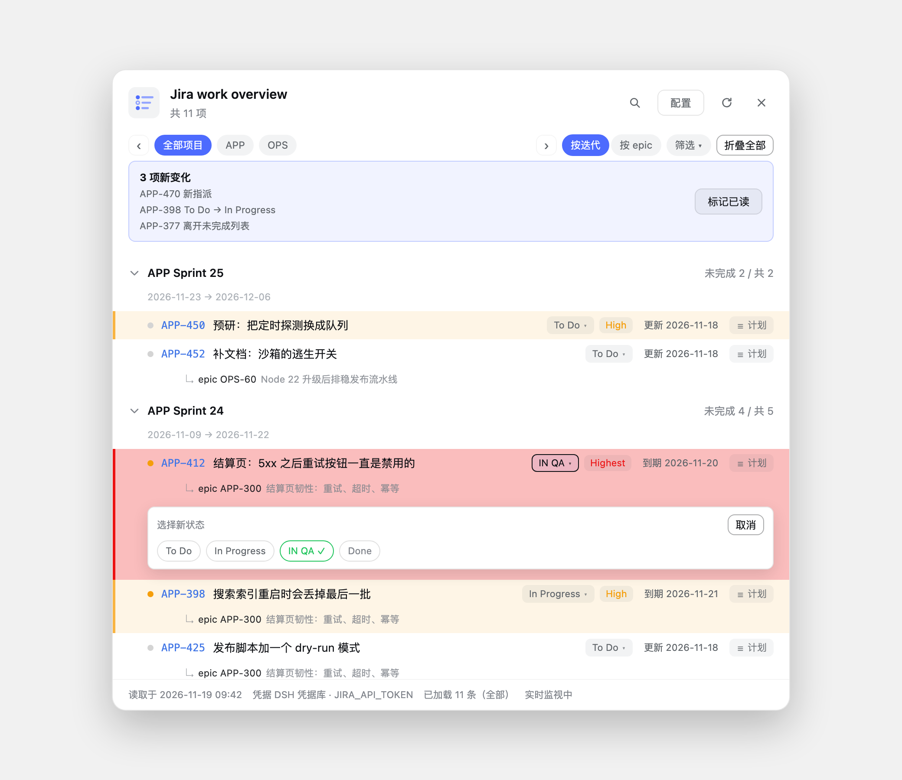
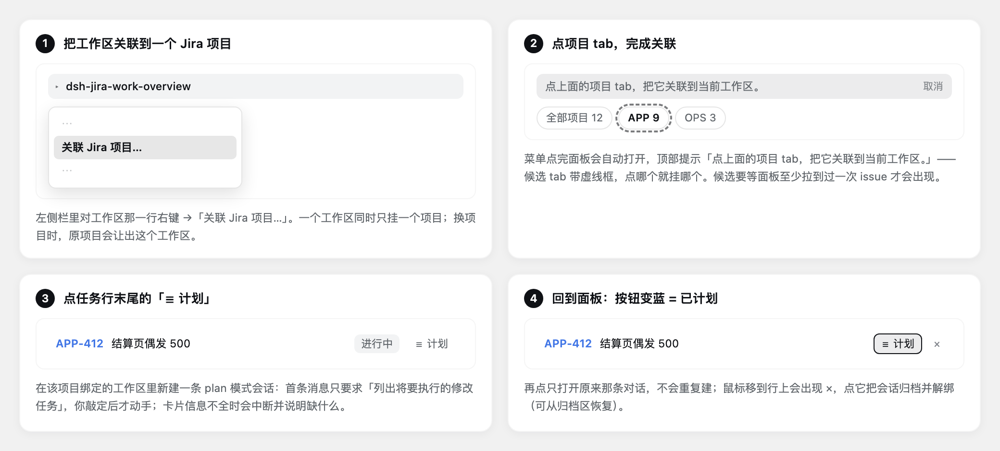
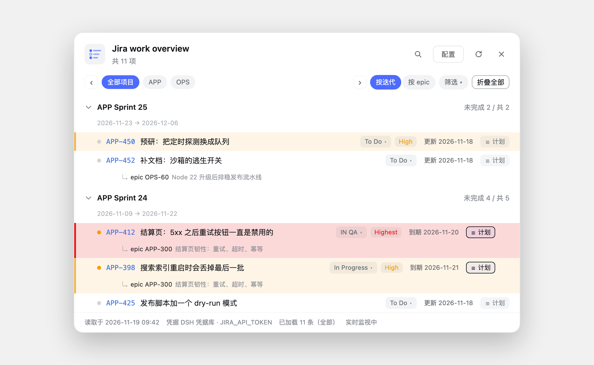
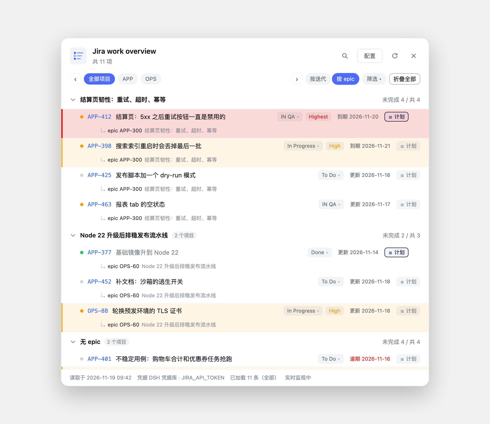

# Jira work overview（包名 `dsh-jira-work-overview`）

在 DSH 里查看**指派给我的 Jira 工作项**以及它们的实时工作流状态，用于快速回答「我这个迭代还要做什么」「哪些已经开发完在等测试」。

[](https://github.com/EagleSoap/dsh-jira-work-overview/actions/workflows/test.yml) [](https://github.com/EagleSoap/dsh-jira-work-overview/actions/workflows/release-check.yml) 每次 push / PR 会在 Ubuntu、macOS、Windows 三个系统上跑整套离线测试；发版前还有内容预检（版本号 ⇄ CHANGELOG ⇄ tag 一致、无个人数据、tarball 文件清单）。GitHub Actions 对公开仓库免费。

<p align="center">
  
</p>

## 提供的工具

| 工具 | 作用 |
| --- | --- |
| `jira_my_work` | 列出指派给我的 issue，按 `statusCategory` 分组为「待办 / 进行中 / 已完成」并给出状态分布。参数：`scope`（`open` 默认 / `sprint` / `all`）、`jql`（自定义 JQL，覆盖 scope）、`status`（只看一个工作流状态名，例如 `IN QA`；空/非法值 = 全部）、`limit`（**0 = 不限制**，一直翻页到没有下一页为止；正数 10–5000；省略则取配置里的「每次拉取条数」）。 |
| `jira_issue` | 读取单条 issue 的完整内容：核心字段、描述（ADF 转纯文本）、可选评论。参数：`key`（必填）、`comments`、`comment_limit`。 |
| `jira_transition` | 读某个 issue **此刻可用的状态流转**（就是面板里那个下拉框），或改状态。参数：`key`（必填）、`to`（目标状态名或流转 id，省略则只列出来）、`apply`（**默认 false 只预览**，true 才真的写入）。 |

## 安装

DSH 用**安装 spec** 装插件 —— 凡是 `pnpm add` 能吃的写法都行（registry 包名、git 地址、tarball、绝对路径）。选一个：

```bash
# 1) 从 npm 装（0.14.0 起已发布；要钉版本就在后面写 @0.16.0）
plugin_manager install_bundle(target="dsh-jira-work-overview")

# 2) 直接从 GitHub 装（不需要 npm 发布）
plugin_manager install_bundle(target="github:EagleSoap/dsh-jira-work-overview")

# 3) 从本地 checkout 装
plugin_manager install_bundle(target="/absolute/path/to/dsh-jira-work-overview")
```

也可以在界面里装：左侧图标栏 → **插件 / Plugins** → 安装，粘同一个 spec。

安装会把 `dsh-jira-work-overview` 加进 profile 的 bundle 列表，并插入 `cordis.patch.yml` 里声明的那行插件。装完要**刷新页面**（Cmd/Ctrl+R），左侧栏才会出现入口。注意 `install_bundle` 返回 `application:"applied"` **不等于**激活成功，真正的判据是 `list_plugins` 里 `include:jira-work-overview` 的 `fiberPhase` 为 `active`（见下面「平台支持」一节的装机检查）。

## 斜杠命令

人在命令面里可以直接用 `/jira`，结果渲染在命令面、不产生模型消息（同一个操作只实现一次，工具与命令共用下面的渲染）。

```
/jira                  未完成的（默认）
/jira sprint           当前活跃迭代里我的
/jira all              我的全部
/jira APP-3489         单条详情（含最近 3 条评论）
/jira <JQL>            自定义 JQL
/jira --json [以上任一种]   同一份数据换成 JSON（左侧栏面板用的就是这个）
/jira --limit=0        这次查询取多少条（0 = 不限制，一直翻页到没有下一页为止；正数 10–5000；安全上限 5000 条 / 50 页 / 30s）
/jira --status=IN QA   只看这一个工作流状态（空间允许，状态名要带引号时把引号去掉）
/jira --search=登录报错  整站全文搜索（摘要 / 描述 / 评论），也可以直接给 issue key
/jira --lang=en        这次输出用哪种语言（zh / en，不改配置）
```

命令通过 `ctx.get('commands')` 注册（不用 `inject`，避免没有命令表面的 profile 让插件停在 pending）；
服务不可用时只往输出里加一行提示，工具照常可用。

预设 JQL：

```
open   : assignee = currentUser() AND statusCategory != Done ORDER BY status ASC, updated DESC
sprint : assignee = currentUser() AND sprint in openSprints()  ORDER BY status ASC, updated DESC
all    : assignee = currentUser() ORDER BY updated DESC
```

## 左侧栏面板

插件还有一个浏览器半边（`client.js`）：在**左侧栏底部、「设置」上方**加入口「Jira work overview」，
点一下在页面中央弹出浮层。


浮层里第一行是**项目 tab** + 右侧的**状态筛选**与「展开全部 / 折叠全部」，
标题下面是「共 N 项」，右上角可刷新，点背板或按 Esc 关闭。

**搜索（和 Jira 搜索框一致）**：点标题右侧的放大镜，它在**原位向左展开**成输入框（带宽度过渡），输入关键词或 issue key 后**回车**。
关键词走 Jira 自己的 `text ~` 全文搜索，范围是**整站**（不只指派给我的，摘要 / 描述 / 评论都会命中）；
输入 issue key 或粘贴 `/browse/APP-123` 链接则直接定位那一条。搜索命中同样按迭代分组，
项目 tab / 状态筛选 / 准确总数都照常可用，所以一眼能看出命中项属于哪个迭代。
输入框**失焦（或按 Esc）就收回按钮**：没回车的草稿下次展开还在；回车执行后输入框清空、结果保留；
`×` 清空搜索并回到「我的工作」。





**查询范围固定为全部**（`assignee = currentUser()`，含已完成 / 已关闭）：原来的「未完成 / 全部」分段控件已按用户
要求删除，想只看某一种状态就用 tab 行右侧的「筛选」（单选，默认「全部状态」）。
**项目 tab**：把这次结果里真正出现的项目（issue key 前缀，跨项目查询）列成一排、每个 tab 带条数；
项目多时用两侧的 `‹` `›` **横向滚动**，点一下只看那个项目（标题下的计数跟着变），再点「全部项目」回到全部；
选中的项目在新结果里消失（那批做完或被改派）会自动回到「全部项目」。
刻意**不**提供「只看当前迭代」的入口：本 board 的 sprint 状态不可信（Sprint 23–29 全报 `future`），
而「未完成」视图本来就是**按迭代分组、列出每个迭代里我未关闭的工作项**。

切换范围时**会中断上一次还没回来的请求**：每次 `load()` 都带上 `AbortSignal`，新请求发起时先
`abort()` 旧的，并且用一个自增序号把旧响应直接丢掉（`if (seq !== loadSeq) return`）。所以快速来回切 tab
不会出现「慢请求晚到、把新列表盖回旧范围」的闪烁；等待期间旧列表留在原位并压暗到 55%（`.jmw-body.pending`），
新数据到达时原子替换。注意 `abort()` 只能中断「等结果」，Host 侧已经发出的 Jira 查询无法撤回。

### 计划会话：绑定工作区 → 点「计划」→ 敲定计划

**任务行末尾的「计划」按钮**：在**该项目绑定的工作区**里新建一条会话，先用 plan 模式做任务规划，
再由你在对话里敲定或修改。第一条消息只要求它「按点列出将要执行的修改任务」，不写解释、背景或分析；
计划由你确认后才执行。这张卡信息不全（没标题 / 没描述 / 没父任务与关联）时，它会**中断**并提示
「Jira 任务不明确，无法进行任务」，同时列出缺什么，不会硬猜着往下做。

建会话用的是 DSH 自己的会话服务（`sessions.create`），所以新会话会立刻出现在侧栏、并当场切到主视图；
`/plan` 与首条消息都按聊天框同一条路发（命令先、消息后），计划对话里的节奏和你在聊天框里开一条新会话一样。
一条任务**只对应一条**计划对话：已经计划过的任务按钮标成 `on`，再点只打开原来那条，不会又开一条。
绑定存在插件的 volatile 配置 `planSessions` 里（一行一条 `ISSUE<TAB>sessionId`）；即使换了浏览器、
清过配置，HOST 也会按计划对话首条消息里的 `JIRA_PLAN_SESSION:<KEY>` 标记翻会话日志把它找回来。
项目没绑工作区（工作区右键 →「关联 Jira 项目…」）时，按钮会直接提示原因，不会建出半成品会话；
第一次用请照下面「四步操作」走一遍。
profile 里装了 `deepseek-ai/dsh-plan-mode` 就用它的 `section` 当规划口径；没装也不影响使用——
首条消息会自带一份「只做规划、只列修改任务、敲定后再执行」的兜底口径。

**删掉一条计划对话**：已计划过的任务行在「计划」旁边多一个 `×`，点它就调基座的工作区归档
（依次尝试 `remote.workspace.archiveSession` / 工作区注册表 `workspaceRegistry.archiveSession` / `connection.call('workspace/archiveSession')`，与侧栏右键「归档」是同一处状态）把那条会话收进归档区，同时清掉绑定；
归档后这一行回到未计划状态，再点「计划」是新建一条。归档不删日志，误删可以从归档区恢复。

**四步操作（图解）**：入口是任务行末尾的「☰ 计划」，但它要求**这个项目已经挂在一个工作区**上——第一次用的人多半卡在这一步。
四步走完，之后每张卡都能一键开计划对话：



1. **把工作区关联到项目**：左侧栏里对工作区那一行右键 →「关联 Jira 项目…」。一个工作区同时只挂一个项目，
   换项目时原项目会让出；已经挂过项目的菜单里会多一条「取消关联 Jira 项目」。
2. **点项目 tab 完成关联**：菜单点完面板会自动打开，顶部提示「点上面的项目 tab，把它关联到当前工作区。」，
   候选 tab 带**虚线框**，点哪个就把哪个挂上去；成功后面板顶部变成「当前工作区已关联 APP」。
   候选 tab 要等面板至少拉到过一次 issue 才会出现——一个候选都没有时先点「刷新」。
3. **点任务行末尾的「☰ 计划」**：在该项目绑定的工作区里新建一条 plan 模式会话，
   首条消息只要求它「按点列出将要执行的修改任务」，由你在对话里敲定；没装 `deepseek-ai/dsh-plan-mode`
   也能用（首条消息自带兜底口径）。
4. **回到面板看状态**：这一行的按钮变蓝（`on`）＝已计划；鼠标移到行上，按钮旁出现 `×`，
   点它把会话归档并解绑（可从归档区恢复）。

对着真实面板，两种状态是这样（上面两行已计划、被框起来）：



**点了没反应或报错时，按这张表对号**：

| 看到什么 | 原因 | 怎么办 |
| --- | --- | --- |
| `项目 APP 还没有绑定工作区：先在左侧侧栏里把项目挂到工作区。` | 这个项目还没挂到工作区（或映射丢了） | 按上面第 1–2 步重新关联 |
| 一个候选 tab 都没有 / `没有可关联的项目：面板里先拉到过 issue 才会出现项目候选。` | 面板还没成功拉到过数据 | 先点「刷新」，必要时先在配置里补站点 / 邮箱 / 令牌 |
| 工作区右键菜单里没有「关联 Jira 项目…」 | 客户端的插件模块没注册上（host 行显示 active 也可能如此） | 重新装插件包并刷新页面 |
| 按钮一直是灰的，点不动 | 上一次建会话还没返回 | 等它结束；失败会显示 `创建计划对话失败：…` |
| 打开的总是同一条对话 | 一个任务只对应一条计划对话（设计如此） | 想重开就先点 `×` 归档，再点「计划」 |
| 首条消息回「Jira 任务不明确，无法进行任务」 | 卡片信息不全：没标题 / 没描述 / 没父任务与关联 | 去 Jira 把这几项补全，再点一次「计划」 |

### 列表怎么分组、怎么高亮

**按 epic 分组**：标题栏的 **按迭代 / 按 epic** 开关把同一批数据换一条线分组——按 Epic Link 归组，横跨多个项目的组在组头标出「N 个项目」，
每行下面仍带自己的 `↳ epic APP-123`，等于不画图也能看到一个层级。



**列表按 sprint（迭代）分组，每一组可折叠 / 展开**：

- 排序：**按 sprint id 从新到旧**，「无迭代」永远垫底。刻意**不**按 Jira 的 sprint 状态（active/future）
  排序、也**不**打「进行中」徽标——本站在用的 board 把 Sprint 23–29 全报 `future`（日期还落在过去），
  跟实际工作安排对不上，标出来只会误导。
- 组头：`▸/▾ 迭代名 + 未完成 N / 共 M`（整组都完成时显示 `M 项全部完成`）；
  组头下一行是迭代区间。**不**显示「进行中 / 结束日已过 N 天」这类迭代状态——本 board 的 sprint 状态
  不可信（Sprint 23–29 全报 `future`、日期还落在过去），标出来只会误导。
- 默认折叠规则：**整组都已完成的组默认折叠**，还有未完成的组默认展开；**tab 行右侧**的「展开全部 / 折叠全部」
  一键切换，折叠状态按「范围 + 迭代」记住。
- **高优先级用整行底色高亮，颜色对比度越强级别越高**：级别**取自 Jira 自己的优先级名次**
  （`GET /rest/api/3/priority` 返回数组的下标，0 = 站点里的最高级），所以站点调了顺序、或者用 `P0` /
  `Blocker` 这类自定义名字也照样对——不是把 `Highest` 写死在客户端。名次 0 = 红底（16% 红）+ 左侧红条，
  名次 1 = 琥珀底（10% 琥珀）+ 左侧琥珀条，再低的不上色（只留徽标）。左侧竖条固定 3px，
  所以不靠色觉也能分辨级别；已完成的行底色减半，免得跟还没做的抢注意力。
  拿不到名次（旧载荷，或站点没暴露这个接口）才退回按名字判断 `Highest` / `High`。
- 行：状态点（待办 / 进行中 / 已完成三色）+ 可点开的 issue key + 摘要 + 状态徽标 + 优先级徽标 + 到期
  （逾期标红；没有到期日就显示更新时间）。
- **从属关系（epic / 父任务）——不靠画布也能看出「非线性关联」**：每行下面带一行
  `↳ epic APP-123 · 标题`（子任务没有 epic 时是 `↳ 父任务 APP-123`），点一下就跳到那条任务（在当前列表里
  就滚过去，不在就打开 Jira）。标题栏的 **按迭代 / 按 epic** 开关把同一批数据换一条线分组：
  按 Epic Link 归组，横跨多个项目的组会在组头标出「N 个项目」。两种视图共用同一套虚拟列表、折叠状态
  与计数，所以切换不重拉、不丢滚动；站点没有 epic 字段时静默退到「无 epic」一组，没有任何关联的行
  不占额外高度。
- **改状态**：点一行的状态徽标（`状态 ▾`）会在该行下面展开一串可选状态——**这不是随便写状态名，
  而是 Jira 工作流此刻允许的流转**，由 Host 现查 `GET /issue/{key}/transitions` 得到；当前状态带 ✓ 且不可点。
  点一个就写入，成功后顶部出现绿色提示 `APP-4051 已改为 IN QA`，**列表只在本地更新这一行**（状态徽标、状态点、
  组头的未完成数与筛选菜单都在本地重算，不再为改一个状态把几百条 issue 重新拉一遍；只有在当前列表里找不到这条时才回退整表刷新）；
  失败（例如某个流转要求必填字段）把 Jira 的报错原样显示在下拉里，不静默吞掉。

- **失败会说人话**：没配令牌 / 站点地址、凭据读不出来、令牌过期（401）、网络不通、站点返回非 JSON，
  面板不再把 Host 的原始报错糊在列表位置，而是标题 + 一句「怎么办」：`去配置` 直接打开令牌弹窗、
  `重试` 重新查询；只有需要看原文的那几类（认证失败 / 网络 / 站点错误）才把原始信息以小字附在下面。
  错误类型来自 `--json` 载荷里的 `error.code`（`no_credential` / `credential_unreadable` / `no_email` /
  `no_base_url` / `auth` / `network` / `http` / `not_json` / `unknown`），不是靠匹配报错文案；
  文本模式的 `/jira` 仍返回原始报错。
- 数据来源就是上面的 `/jira --json`：client 半边用
  `ctx.remote.commands.execute(sessionId, '/jira --json all --limit=0 [--status=<名字>] --lang=<lang>', [])`
  在**当前会话**上执行该命令，再解析 JSON
  （分组由 host 侧算好放在 `sprints`，`items[].sprintId` 是归属）。
  同一个操作只实现一次，命令面与面板共用同一套 host 逻辑。
- 入口注册在 `sidebar.footer.action`，浮层注册在 `shell.overlay`。宿主只提供「透明、click-through 的浮层座位」，
  背板、Esc 关闭、Tab 焦点陷阱都由插件自己实现。
- `client.js` 不 import 任何 `@deepseek-ai/*` 客户端包（安装包里没有这些包，只有前端构建产物才内联它们），
  只从宿主模块表 `require('react')`；`react-dom` 只用来 `createPortal`，取不到就退回内联绝对定位。
  虚拟列表用的 `@tanstack/react-virtual` 也直接从这个模块表 `require`（与 `react` / `react-dom` / `zustand` 同级）。
- 文案优先用宿主 locale（`ctx.get('locale')` 的 `register` + `bind`），拿不到就回退 `client.js` 内置的中英文案
  （跟随 `navigator.language`）。`locale/*.json` 只用于插件列表里的标题/描述，运行时不会被加载。

## 查询范围与条数

- **面板的范围固定为全部**：它永远发 `assignee = currentUser()`（含已完成 / 已关闭），原来的「未完成 / 全部」
  分段控件已删。**状态筛选**是单选：`--status=<状态名>` 会在 JQL 里追加 `AND status = "<名字>"`，
  而且**必须插在 `ORDER BY` 之前**（`withJqlClause()` 负责这件事；写反了真站点会回 400「ORDER BY must be the last one」）。
  状态名先 trim、去掉 `"`，含 `\u0000-\u001f` 控制字符的整串忽略（与 `--limit` 同一个口径）；空串 = 全部。
- 命令行 `/jira` 不带范围词时**仍然默认 `open`**（`SCOPE_JQL.open` 也是后台监视用的那条，通知行为没动）；
  `/jira sprint`、`/jira all` 照旧。只有面板固定发 `all`。
- 查询是**一次全局 JQL**，**不带项目和迭代过滤**——项目与迭代的过滤/分组都在拿到结果之后做（项目 tab、按迭代分组）。
- 配置里的**「每次拉取条数」默认 `0` = 不限制**（一直翻页到没有下一页为止），不是「每个迭代各查 N 条」。
  0 之外的合法范围是 **10–5000**；Jira 单页最多返回 100 条，插件会自动翻页
  （`MAX_PAGES = 50`，50 × 100 = 5000）直到 `isLast` / 没有 `nextPageToken`。
- **安全上限**：50 页 / 5000 条 / `timeoutMs`（默认 30s）三者谁先到就停。撞到上限时插件**不假装取完了**：
  工具输出保留「**还有更多**」那一行并写明真实的安全上限，结构化输出里 `hasMore: true` / `limit: <上限>`。
  真站点实测 332 条要 4 页，`--limit=0` 一次就取完（面板页脚会写「已加载 332 条（全部）」）。
- 三个位置能调这个上限：面板「配置」→「查询」→「每次拉取条数」（改了就生效）、命令 `/jira --limit=100`、
  工具参数 `jira_my_work(limit=100)`；所有地方统一：**0 = 不限制**，正数 clamp 到 **10–5000**。
  面板自己**固定发 `--limit=0`**（面板要靠虚拟列表撑住任意条数），所以「加载更多」按钮只有撞到安全上限时才会出现，
  且是禁用状态——上限已经顶到底，没有可抬的空间。

### 虚拟列表：不管多少条只渲染视口内的行

- host 侧不再有「条数上限」这个概念（只剩安全上限），面板固定 `--limit=0` 把结果一次全拿到。
- client 侧**手写 DOM（`React.createElement`）**，但用 **`@tanstack/react-virtual`** 做虚拟列表：
  `@tanstack/react-virtual` 与 `react` / `react-dom` / `zustand` 同在**基座模块表**（11 个模块）里，
  client 半边可以直接 `require('@tanstack/react-virtual')`，不需要额外打包。
- 把可见行拍平成一维序列 `[{kind:'group'}, {kind:'item'}, {kind:'empty'}]`（按当前项目 tab + 状态筛选 +
  折叠状态生成；折叠的组只产出组头），然后
  `useVirtualizer({ count, getScrollElement: () => 真正滚动的 .jmw-body, estimateSize: () => 32, overscan: 10, measureElement })`：
  用 `getTotalSize()` 撑高一个占位容器 `.jmw-vlist`，只有 `getVirtualItems()` 给的窗口内的行真的在 DOM 里，
  每行 `.jmw-vrow` 用 `transform: translateY(start)` 绝对定位，并挂 `ref` + `data-index` 让 `measureElement`
  量真实行高（状态下拉展开、长标题换行都能重新量到）。
- 所以**不管 400 条还是 5000 条，DOM 里的行数都只和视口有关**；滚动、组头、空态、「加载更多」都在同一个
  滚动容器里。
- 万一根基座模块表里拿不到 `@tanstack/react-virtual`（理论上不会），client **不崩**：退回「直接渲染全部行」
  并 `console.warn` 一次。
- 上一版（0.11.0）的「渐进式渲染」（`RENDER_FIRST = 80` / `RENDER_STEP = 120` / 「正在渲染 N / M 行」）**已整套删除**，
  换筛选 / 换 tab / 刷新后不会再有「分批画」的残留状态，滚动位置在切筛选、换 tab、刷新时重置到顶部。

### 「共 N 项」是准确总数，不是页内条数

- **标题下面**的副标题会显示「**共 N 项**」（有状态筛选时再拼一句「· 状态 <名字>」），这个数字来自 Jira 的
  `POST /rest/api/3/search/approximate-count`（只回一个 `count`，不拉数据）——实测与「自己翻页把结果全拉完」完全一致：
  未完成 9 = 9、全部 332 = 332（4 页）。
- 数字随**当前筛选与当前项目 tab** 变：选「全部项目」时是整个范围（含已完成）的总数；选了某个项目 tab 就显示该项目
  在当前范围下的总数（每个项目一次 count，最多统计 8 个项目，超过就只给总数）。
- **拿不到就不显示**（当年查询失败、count 端点不可用时副标题里没有数字，只留状态筛选那半句），宁可空着也不给一个会跳的数。
- 项目 tab 上**不再显示数量**（用户 2026-11-18 要求）：页内量看页脚的「已加载 N 条（全部）」（撞到安全上限时写「已达安全上限 5000 条，还有更多」），总量看这个「共 N 项」。

## 实时监视（有工作派过来就会知道）

Jira Cloud **没有**给第三方 issue 事件的 websocket / SSE 长连接（官方推送只有 webhook，需要 Jira 管理员配置一个
公网可达的地址），所以“实时”由插件自己在 Host 侧轮询实现：

- **Host 轮询**：每 `watchIntervalMs`（默认 60s）查一次「指派给我且未完成」的 issue，和上一轮比对。
  新增指派 / 状态变化 → 弹一条**系统通知**（macOS 用 `osascript`、Windows 用 PowerShell 的 WinRT Toast、
  其它平台试 `notify-send`；见「平台支持」），并记进未读变化；
  issue 离开未完成列表只记不弹（多半是刚做完，不值得打扰）。第一轮只建基线，不通知。
- **自己改的不打扰**：面板下拉或 `jira_transition` 写入时，Host 会先记下这次流转的「起点 → 终点」；
  下一轮轮询命中这对值就直接推进基线，不弹通知、不进未读角标、不进横幅。对账只认这一对，
  同事把同一个 issue 改成别的状态照样通知；写失败会立刻撤掉这份期望，不会吞掉之后别人的真变化。
- **面板角标**：入口按钮右上角显示未读条数；面板顶部出现「N 项新变化」横幅（列出最近几条，
  如 `APP-4018 In Review → IN QA`）和「标记已读」按钮；面板开着时又来新变化会自动刷新列表。
- **通道**：Host 在 `ctx.get('connection').fetch` 上注册四条精确路由——`/api/jira-work-overview/state`
  （GET = 状态，支持 `?wait=25000` 长轮询；POST = 标记已读）、`/api/jira-work-overview/transition`
  （GET `?key=…` = 可用流转；POST `{key, transitionId}` = 改状态）、`/api/jira-work-overview/credential`
  （GET = 令牌状态（打码）；POST = 保存 / 清除令牌）与 `/api/jira-work-overview/settings`
  （GET = 可改的监视设置当前值；POST = 写 `watchEnabled` / `watchIntervalMs` / `notify`），
  client 半边全部走这四条。
  **没有走 `/jira` 命令**：每次命令执行都会往会话日志里写 `command/run` + `command/done`，
  拿它轮询会把聊天记录刷爆。
- 通道不可用（老宿主 / 没注册成功）时，面板页脚会显示「实时监视不可用（原因）」，工具照常工作，
  系统通知也不受影响。

> 如果你更希望“毫秒级实时”，正路只有两条：让 Jira 管理员配 webhook + 内网穿透（需要公网地址），
> 或者用 DSH 的定时任务让 agent 定时来问（每次都要跑模型，比本机轮询贵得多）。

## 换令牌（插件配置页）

**入口（三个，内容一样）**：
① 最省事：打开左侧栏那个 **Jira work overview** 面板 → **标题右侧**有 **「配置」** 按钮，
点一下弹出独立的令牌弹窗（Esc 或点遮罩先关弹窗、再关面板）；
② 插件页 → 点开 **Jira work overview** → 描述下面就有一段「Jira 令牌」
（client 半边注册在 `plugins.bundle.config`，key 是包名 `dsh-jira-work-overview`）；
③ 另外该 bundle 里那行 `jira-work-overview` 的标题也是可点的（带一个小箭头），点进去是同一个页面
（注册在 `plugins.row.config`，key 是 `<包名>#<row id>`，即 `dsh-jira-work-overview#jira-work-overview`）。
页面内容：

- **当前令牌**打码显示成首尾各 4 位（如 `ATAT…0000`），并标出来源（DSH 凭据库 / 环境变量 / 插件配置明文）；
  完整令牌只在 Host 进程里用于拼 Basic 认证头，**任何响应都不回传**（`GET` 路由只给 `masked` 与 `length`）。
- **账号邮箱也能改**（`email` 同样是 `.volatile()` 字段）：它和令牌是**一对**——Basic 认证就是 `邮箱:令牌`，
  所以改邮箱会**连当前令牌一起验证**（`GET /rest/api/3/myself`），401/403 时**两边都不写**并提示
  「这个邮箱 + 令牌的组合 Jira 不认」；通过才写（邮箱落到 profile 的 Cordis patch、令牌落到凭据库）。
  只改邮箱、不填新令牌也可以（用当前令牌验证）；邮箱格式不对会直接 400。
- **新令牌**输入框是 `type=password`，按钮是「**保存并验证**」：先拿「邮箱 + 令牌」打一次 `GET /rest/api/3/myself`——
  401/403 直接拒绝并原样报出 Jira 的话（不会把插件写成打不通的状态）；只有网络层失败才「照存但提示」。
  没填新令牌、也没改邮箱时按钮是禁用的。
  验证通过才 `ctx.credentials.set(credentialKey, token)`，**写入位置与原来完全一致**（默认 `JIRA_API_TOKEN`），
  写完立刻生效（`token()` 每次都现读凭据库，不用重启 DSH）。
- **清除令牌**是两步（第一次点变「确认清除？」），走 `credentials.unset`。
- **后台监视**：开关 + 检查间隔（按秒填，最小 15）+ 通知开关，下面有小字说明。
  **这三个是「改了就生效」**：拨开关立刻写、间隔输入后失焦 / 回车立刻写（输入过程中 700ms 防抖），
  **没有保存按钮**——只有令牌那种敏感值才需要点按钮确认落库（详见「配置」一节）。
- 页面按功能分成四组，每组是「标题 + 内容」：**认证令牌**（邮箱 + 令牌都能改）/ **Jira 连接**（服务地址可改：
  输入框留空 = 不修改，placeholder 显示当前生效地址，点「保存地址」立刻写进 profile 并生效）/
  **查询**（每次拉取条数可改 + 请求超时只读）/ **后台监视**（开关 + 间隔 + 通知，改了就生效）。
  （项目名与看板 id 不再出现在配置页——面板上方的项目 tab 已经能自由切换项目了。）
- 页面底部说明「令牌只写进 DSH 凭据库 + 界面只显示打码首尾」，并给一条去 Atlassian 新建/吊销令牌的链接。
- 按钮颜色写在元素的内联 `style` 里，而且是**写死的深底 + 白字**（主按钮 `#4d6bfe`、危险动作 `#d64545`）：
  只靠注入的 `<style>` 时宿主后加载的样式表会把「保存」按钮刷成一个纯白块；而用
  `var(--dsw-alias-brand-primary)` 当底色更糟——浅色主题下这个 token 接近黑、**深色主题下接近白**，
  配白字就是「白底白字」（这两个坑用户都遇到过）。
- 关面板（× / 点遮罩 / Esc 最后一层）会把**所有浮层一起收掉**（令牌弹窗、状态下拉）；再次点开入口
  只显示任务列表，不会两个弹窗叠着出现。

> 为什么不用配置字段：宿主设置表单（`ConfigForm` / `settingsSchema`）只写 Host 设置文档，
> 没有 secret / credential 类型的字段，所以「填令牌」这件事必须由插件自己贡献配置页 + 自己的写通道。

### 界面语言（自动 / 中文 / English）

配置弹窗最上面的「界面」分组里可以直接选：**自动**（默认）= 先跟 DSH 的语言设置（设置 → 通用 → 语言），DSH 没设过就跟浏览器语言；**中文** / **English** = 强制。选完立刻生效（写进当前 profile 的 Cordis patch，不用重启），Jira 返回的任务信息始终原样展示。宿主侧的工具输出与通知语言也跟着它走——面板每次请求都会把界面语言捎给 host（命令行 `--lang=`、路由 `?lang=`），所以两边的文案不会打架。

## 语言（i18n）

插件只做 **中文 / 英文**两种语言（其它语言一律回落英文），**只翻译插件自己的硬编码文案**：
工具描述与参数、工具输出、通知、错误与提示、面板里的每一行字。**从 Jira 取回的数据一律原样展示**——
issue 摘要、状态名（`In Review`、`已完成`…）、父需求名、标签、sprint 名、账号名都不会被翻译。

语言来源（优先级从高到低）：

1. `DSH_JIRA_LANG` 环境变量（手动 / 测试强制定死）；
2. 本次操作的覆盖：`/jira --lang=zh`、以及面板请求带的 `?lang=zh`；
3. 插件配置的 `language`（`zh` / `en`；`auto` 表示跳过这一层）；
4. **DSH 的语言设置**（设置 → 通用 → 语言）——读宿主 `settings` 服务里 `locale` 命名空间的 `preference`；
5. 系统环境（`LANGUAGE` / `LC_ALL` / `LANG`）；
6. Node 的 ICU 默认语言（`Intl.DateTimeFormat().resolvedOptions().locale`）；
7. 兜底 `en`。

浏览器半边另外会在 `ctx.locale` 上注册同一份字典，并订阅 `locale/change`：**在 设置 → 通用 → 语言 里切一下，面板立刻跟着换**；
面板每次请求都会把当前语言捎给 host（命令行走 `--lang=`、四条路由走 `?lang=`），因此**同一次操作里界面与数据行的语言是一致的**。
注意：工具描述、参数描述、命令描述是**注册时**取值的（DSH 的已知限制：这类文案不随语言切换实时变），改语言后重装或重启才刷新。

## 打开 cordis.patch.yml

配置弹窗里有一个「**配置文件**」分组：显示当前 profile 的 patch 文件路径（可一键复制），并提供三种通用打开方式，
外加**编辑器直选**与**自由输入**：

| 按钮 | macOS | Windows | Linux |
|---|---|---|---|
| 用默认程序打开 | `open <path>` | `cmd /c start "" <path>` | `xdg-open <path>` |
| 选择打开方式… | `osascript` 的 `choose application` + `open -a` | `rundll32 shell32.dll,OpenAs_RunDLL <path>` | 没有系统级选择器，返回「不支持」 |
| 在文件管理器中显示 | `open -R <path>` | `explorer /select,<path>` | `xdg-open <父目录>` |
| 编辑器直选（VS Code / Cursor / …） | `open -a "<App 名或路径>" -- <path>` | 探测到的 `Code.exe` 等直接执行；只有命令名（如 `code`）时退化成 `cmd /c start "" <app> <path>` | `<命令名> <path>`（如 `code <path>`） |
| 自由输入（应用名或完整路径） | `open -a "<你填的>" -- <path>` | 是存在的 `.exe` 路径就直接执行，否则 `cmd /c start "" <你填的> <path>` | `<你填的> <path>` |

### 编辑器直选

- **只画本机真的装了的编辑器**：host 侧 `detectEditors()` 会探测候选表里的编辑器，探到哪个才画哪个按钮；
  **一个都没探到就不画按钮**，改成一行小字「没有探测到已安装的编辑器」。
  宁可少一个入口，也不给用户一个点下去必然报错的按钮——这也是它不做「自动安装 / 自动下载」的原因。
- 候选与探测方式：

  | id | 名字 | macOS（扫 `/Applications`、`~/Applications`、`/System/Applications`） | Windows | Linux（在 `PATH` 里找命令） |
  |---|---|---|---|---|
  | `vscode` | VS Code | `Visual Studio Code.app` | `where code`，再试 `%LOCALAPPDATA%\Programs\Microsoft VS Code\Code.exe` | `code` |
  | `cursor` | Cursor | `Cursor.app` | `where cursor`，再试 `%LOCALAPPDATA%\Programs\cursor\Cursor.exe` | `cursor` |
  | `windsurf` | Windsurf | `Windsurf.app` | `where windsurf`，再试 `%LOCALAPPDATA%\Programs\Windsurf\Windsurf.exe` | `windsurf` |
  | `zed` | Zed | `Zed.app` | — | `zed` |
  | `sublime` | Sublime Text | `Sublime Text.app` | `%ProgramFiles%\Sublime Text\sublime_text.exe` | `subl` |
  | `textedit` | TextEdit | `TextEdit.app`（系统自带） | — | — |
  | `notepad` | Notepad | — | `notepad.exe`（系统自带） | — |
  | `gedit` | gedit | — | — | `gedit` |

- 点某个编辑器打开之后，它的 id 会记进配置的 `preferredEditor`，下次那个按钮上带一个「（上次用过）」标记。
  记偏好失败不影响本次打开。
- Linux 侧交给系统的是**命令名**而不是绝对路径（`execFile('code', [patchPath])`），跟随用户的 `PATH`；
  Windows 侧若 `where` 只给到命令名或用户填的是应用名，就用 `cmd /c start` 兜底。

### 自由输入

- 「用指定应用打开」是一个纯文本框：填应用名（如 `Code.exe`）或完整路径都行，成功后自动清空。
- 输入会被 trim；**空输入、含换行或其它控制字符（`/[\u0000-\u001f]/`）直接 400 拒绝**。
- 这个值始终作为**一个 argv 参数**交给启动器（macOS `open -a` 的 `-a` 后面、Windows `start` 的一个参数、
  Linux `execFile` 的一个参数），**绝不拼 shell 字符串**，所以路径里有空格、引号也不会被解释成命令。
- 自由输入不记 `preferredEditor`（只记已知的编辑器 id）。

- 路径来自宿主 `settings` 服务的 `documentPath`，取不到时回退 `$DSH_PROFILE_DIR/cordis.patch.yml`。
- **「选择打开方式…」是发射后不等的**：系统选择器会一直等用户选完，所以 host 立刻返回、不挂住界面；用户取消不算错误。
- host 侧只接受「绝对路径且以 `cordis.patch.yml` 结尾」的目标，不接受任意路径。
- ⚠️ 这个文件里除了本插件的配置，**可能还有其它插件的明文配置**，别外发。

> 为什么自己实现：DSH 官方的 open-in-app（`dsh-client-ui-open-in-app` → `ctx.remote.session.openWorkspacePath`）
> 会用 composed filesystem 校验路径，**会话工作区之外的文件一律被拒**；官方推荐的 `dsh-apiproxy.openPath`
> 在这套 profile 里没有安装。

## 平台支持（macOS / Windows / Linux）

平台的差异只集中在两处：**弹通知**与**打开配置文件**（都由 host 半边按 `process.platform` 分派）。
其它部分：host 只用 `fetch` / `AbortSignal.timeout` / `setInterval` / `node:child_process`，
不拼路径、不读 `/tmp`、不依赖 shell 特性；client 半边是标准 React + DOM，键盘只认 `Escape`、`Enter`、`Tab`，
不用 `Cmd`/`Ctrl` 组合键。DSH 桌面端在三个平台都是 Electron，`connection.fetch`、`__DSH_TRANSPORT__`、
槽位与凭据库的行为一致。

| 事项 | macOS | Windows | Linux |
|---|---|---|---|
| 通知 | `osascript`（系统自带） | `powershell.exe` + WinRT Toast（Win10+ 自带），AUMID 依次试 `DSH_NOTIFY_AUMID` 环境变量 → `DeepSeek Harness` → PowerShell 自己的 AUMID | `notify-send`（装了 libnotify 才有） |
| 通知不可用时 | 静默：面板里仍有角标与横幅 | 同左（组策略禁用 PowerShell、或没有交互式桌面会话时也会静默） | 同左 |
| 打开配置文件 | `open` / `open -R` / `choose application` 全支持 | `start` / `explorer /select,` / `OpenAs_RunDLL` 全支持 | `xdg-open`，「选择打开方式」不可用 |
| 编辑器直选 | 扫 `/Applications`、`~/Applications`、`/System/Applications` 找 `.app`，用 `open -a` 启动 | `where` + `%LOCALAPPDATA%` / `%ProgramFiles%` 已知路径；非 `.exe` 路径用 `cmd /c start` 兜底 | 在 `PATH` **加**常见安装位（`/usr/local/bin`、`/snap/bin`、flatpak exports、`~/.local/bin`、`~/.nix-profile/bin`、JetBrains Toolbox）里找可执行文件，用找到的**绝对路径**启动 |
| 自由输入应用名 / 路径 | `open -a <你填的> -- <path>` | 存在的 `.exe` 直接执行，否则 `cmd /c start "" <你填的> <path>` | `execFile(<你填的>, [path])` |
| 界面字体 | 走宿主变量，回退 `-apple-system` / `PingFang SC` | 回退 `Segoe UI` / `Microsoft YaHei`；等宽 `Consolas` / `Cascadia Mono` | 回退 `system-ui` |
| 项目 tab 横向滚动 | 隐藏滚动条 + 两侧 `‹ ›` 按钮 | 细滚动条（Windows 没有 overlay scrollbar，**不能藏**）+ 两侧 `‹ ›` 按钮 | 同 Windows |
| `PATH` 分隔符（编辑器探测） | `:` | `;`（盘符里的 `:` 不能当分隔符） | `:` |

编辑器候选表里给了 Linux 命令名的：VS Code（`code`）、Cursor（`cursor`）、Windsurf（`windsurf`）、
Zed（`zed`）、Sublime Text（`subl`）、gedit（`gedit`）——**找到可执行文件才画按钮**，找不到就不画，不猜。
桌面启动器起的 Electron 不继承登录 shell 的 `PATH`（典型只有 `/usr/bin:/bin`），所以探测会把上面那串常见安装位
也加进来；按钮里存的是探测到的绝对路径，点下去不依赖进程的 `PATH`。

**配置文件路径**接受三种「绝对」：`/…`、`C:\…` / `C:/…` 盘符、`\\server\share\…` 网络共享
（公司里 profile 目录被重定向到共享盘时就是这一种）。

**已知边界**：Windows 上用 `cmd /c start` 打开时，若路径里含 `&`、`%` 这类 `cmd` 元字符，
参数可能被 `cmd` 重新解释；路径来自 DSH 自己的 profile 位置，正常安装不会碰到。`explorer.exe /select,`
即便成功也常返回 1，插件只把「起不来」当失败，不会误报打不开。

**Linux 上的实现状态要说清楚**：平台的差异全部按 `process.platform` 分派实现，并有离线套件覆盖，
**但从来没有在 Linux 机器上真跑过**（开发一直在 macOS）。所以「Windows / Linux 支持」是**实现了、未经实机验证**，
不是「已在三平台验证通过」。Linux 上只有一处是设计上的缺口：「选择打开方式」没有桌面门户的等价物，
只提供 `xdg-open` / 编辑器直选 / 自由输入命令三种方式。「在文件管理器中显示」在 Linux 上退化成打开所在目录
（没有统一的「选中这个文件」动作）。

**在 Windows 上装这个插件的注意点**

1. **路径里尽量别有空格**。本机现在放在 `…/Project/dsh plugins/dsh-jira-work-overview`（`dsh plugins` 带空格）；
   DSH 装 bundle 时是把绝对路径写进 profile 的 `link:` 依赖，带空格的路径在 Windows 上更容易出问题。
   建议 Windows 上放到 `C:\Users\<你>\dsh-plugins\dsh-jira-work-overview`（或先确认装完
   `<profile>\node_modules\@local\dsh-jira-work-overview` 这个 junction/symlink 指对了）。
2. 装完照例看两件事：`install_bundle` 返回 `application:"applied"` **且** `list_plugins` 里
   `include:jira-work-overview` 的 `fiberPhase` 是 `active`（`applied` 只代表写了配置，激活失败只在 `diagnostic` 里）。
3. 凭据库路径、`JIRA_API_TOKEN` 环境变量、`credentialKey` 都不区分大小写，Windows 上同样能用；
   token 仍存在 DSH 凭据库里（`%USERPROFILE%\.dsh\.credentials.yaml`）。
4. 企业网要走代理时：Node 的 `fetch` **默认不读** `HTTPS_PROXY`；给 DSH 进程配 `NODE_USE_ENV_PROXY=1`
   （Node 24 的 `--use-env-proxy`）或改用能直连 Jira 的网络。
5. 开发用的 `test/*.mjs` 已改成用 `os.tmpdir()`（可用 `DSH_JIRA_TMP` / `DSH_JIRA_ENV_FILE` 覆盖），
   没有 env 文件时会自己开一个空的（凭据可用 `JIRA_API_TOKEN` / `JIRA_BASE_URL` / `JIRA_EMAIL` 环境变量给，
   连不上站点就 `SKIP`），但它们依赖从 `app.asar` 里抽出来的宿主 peer 依赖副本，仍建议在 macOS/Linux 上跑测试。
   出图脚本 `test/dsh-jira-shot.mjs` 现在会按平台找无头 Chrome（也可用 `DSH_JIRA_CHROME` 指定）。

## 配置

`index.js` 导出 `Config`（schemastery schema），所以这些字段会出现在插件管理器里：常规字段可直接改，`apiToken` 只为兼容旧版明文配置保留。

| 键 | 默认值 | 说明 |
| --- | --- | --- |
| `baseUrl` | `''` | Jira 站点地址，例如 `https://your-site.atlassian.net`（必填） |
| `email` | — | 登录邮箱，Basic 认证用 |
| `credentialKey` | `JIRA_API_TOKEN` | 去 DSH 凭据库里找 token 用的键名 |
| `projectKey` | `''` | 仅用于展示 |
| `boardId` | — | 仅用于展示 |
| `maxResults` | `0` | 每次拉取条数。**`0` = 不限制**（一直翻页到没有下一页为止）；正数范围 10–5000。安全上限 5000 条 / 50 页 / `timeoutMs` 超时 |
| `timeoutMs` | `30000` | 工具调用超时 |
| `watchEnabled` ✏️ | `true` | 后台定时检查新指派 / 状态变化（关掉就只手动刷新） |
| `watchIntervalMs` ✏️ | `60000` | 后台检查间隔（毫秒），最小 15000；界面上按「秒」填 |
| `notify` ✏️ | `true` | 有变化时弹系统通知（macOS `osascript` / Windows PowerShell Toast / 其它 `notify-send`） |
| `language` | `auto` | 界面与工具输出用哪种语言：`auto` / `zh` / `en`（见下面「语言」一节） |
| `preferredEditor` | 空 | 上次用来打开配置文件的编辑器 id（由面板写入，用来标「上次用过」；一般不用手改） |
| `apiToken` | 空 | 旧版明文 token，首次加载会自动迁移进凭据库，迁移后应清空 |

**API token 不进配置**：它存在 DSH 凭据库里（`ctx.credentials`，键名即 `credentialKey`）。
解析顺序是 **DSH 凭据库 → 环境变量 → 插件配置的 `apiToken`**；凭据库最优先。
如果配置里还留着旧版明文 `apiToken`，插件在加载时会用 `credentials.resolve` + `credentials.set` 把它搬进凭据库、
写入后回读确认，成功才清空内存里的明文，并在工具输出的「凭据来源」一行里报告实际来源。

**带 ✏️ 的三项在面板里就能改，而且是「改了就生效」**：`watchEnabled` / `watchIntervalMs` / `notify` 在
`Config` 里声明成了 `.volatile()`，所以配置页（面板标题右侧「配置」按钮）能直接写这三项——拨开关立刻写，
间隔输入后失焦 / 回车立刻写（输入中 700ms 防抖），**没有保存按钮**；写入走宿主 `settings` 服务的
`mutate(ns, ops, revision)`，落到**当前 profile 的 Cordis patch**，并由 `loader/volatile-update` 立刻提交到
运行中的引用：**不用重启 DSH、不用重装插件，下一次检查就按新间隔跑**。写失败会把界面回退成服务器上的值并报错，
不会让人误以为已经生效。插件同时监听 `loader/volatile-update`
（例如你直接改文件时），收到就把自排程的定时器按新值重排。

**其余字段**：上面这张表是 profile 的 `cordis.patch.yml` 里那一行 `config:` 的字段（`apiToken` 除外，
它只为兼容旧版明文配置保留）。宿主**不会**自动给第三方插件渲染设置表单——Host 设置文档
（`ConfigForm` / `settingsSchema`）里也没有 secret 字段类型，所以插件自己贡献了那一行的配置页
（见上面「换令牌」一节）：配置页负责**换令牌**、**站点地址**、**邮箱**与上面三项监视设置，`maxResults`
（**0 = 不限制**，正数 10–5000）也在这里改；只有超时在「查询」组里只读列出。要改只读项，
直接改 `cordis.patch.yml` 那一行（或让 agent 改）后重新加载插件。

## 版本与升级

当前版本 **0.16.0**（2026-11-20）。`CHANGELOG.md` 记了 30 个版本（0.1.0 起），GitHub 上有 **9 个 tag / Release**（0.13.0 → 0.16.0），**0.13.4 是第一个公开版本**——更早的 0.1.0–0.12.0 只存在于 `CHANGELOG.md` 与项目记录里，没有对应的提交与 tag，所以「以前的版本」= **0.13.0 及以后**。逐版的完整说明见 [CHANGELOG.md](CHANGELOG.md)。

### 为什么有人还在装以前的版本

- **0.14.0 之前 npm 上没有这个包**：那段时间只有 GitHub 直装 / 本地路径两种装法，`plugin_manager install_bundle(target="dsh-jira-work-overview")` 会直接找不到包。旧的安装命令不会自己升级——装的是哪个 spec，就一直停在那个版本。
- **0.13.0 / 0.13.1 的浏览器半边根本不加载**（见下表）：左侧栏入口、面板、令牌配置全都不出现，而 `plugin_manager` 仍显示 `fiberPhase: "active"`，很容易被当成「这个插件坏了」。遇到这种情况先升级到 0.13.2+。
- **0.15.0 及更早版本的配置页会报「读取令牌状态失败：HTTP 404」**，而且角标、状态下拉、后台监视表单一起失效（同一个根因）。0.15.1 修好；从 0.15.1 起升级**不用重填邮箱 / 令牌**。

### 版本历史

| 版本 | 日期 | 类型 | 一句话 |
| --- | --- | --- | --- |
| 0.1.0 | 2026-11-18 | 初版 | `jira_my_work` / `jira_issue` 两个工具、`Config` 卡片、令牌走凭据库 |
| 0.2.0 | 2026-11-18 | 功能 | `/jira` 斜杠命令（不产生模型消息）、scope / issue key / 原始 JQL 参数 |
| 0.3.0 | 2026-11-18 | 功能 | 左侧栏 **客户端面板**；数据走 `ctx.remote.commands.execute('/jira --json')` |
| 0.4.0 | 2026-11-18 | 功能 | 按**迭代**分组（可折叠）、sprint 字段按 `schema.custom` 解析 |
| 0.5.0 | 2026-11-18 | 功能 | **实时监视**：后台轮询 + 系统通知 + 未读角标 + 「新变化」横幅 |
| 0.6.0 | 2026-11-18 | 功能 | 面板里**改状态**（工作流 transition）+ `jira_transition` 工具 |
| 0.7.0 | 2026-11-18 | 功能 | 高 / 最高优先级行底色 |
| 0.7.1–0.7.3 | 2026-11-18 | 修复 / 精简 | 去掉不可信的「活跃迭代」行；切换时中止上一个请求 |
| 0.8.0 | 2026-11-18 | 功能 | **API 令牌**在插件自己的配置页里编辑（打码、`/myself` 校验、坏令牌不写入） |
| 0.8.1–0.8.6 | 2026-11-18 | 功能 | 多个配置入口、令牌弹窗、监视开关 → **改了就生效**、**项目 tab** |
| 0.8.7–0.8.10 | 2026-11-18 | 功能 | 登录邮箱可编辑、**Windows / Linux 支持**、界面语言、可配置拉取条数 |
| 0.9.0 | 2026-11-18 | 功能 | **国际化**（中 / 英词典、按 DSH 语言自动切换） |
| 0.10.0 | 2026-11-18 | 功能 | 准确总数（`projectTotals`）、编辑器直选；修复 JQL 条件插到 `ORDER BY` 之后 |
| 0.11.0 | 2026-11-18 | 功能 | **状态筛选**（单选、服务端 `--status`）、按 `approximate-count` 的准确总数 |
| 0.12.0 | 2026-11-18 | 功能 | **虚拟列表**（`@tanstack/react-virtual`）、`maxResults: 0` = 不限制 |
| 0.13.0 | 2026-11-18 | 发布准备 | 包名改成 `dsh-jira-work-overview`、MIT、`cordis.patch.yml` 只留中性默认值 |
| 0.13.1 | 2026-11-18 | 清理 | 删掉三个过时的测试套件 |
| 0.13.2 | 2026-11-18 | **修复** | 浏览器半边不加载：bundle id 与包名不一致 |
| 0.13.3 | 2026-11-18 | 修复 | 折叠全部后组头错位；滚动时 macOS 整屏闪 |
| 0.13.4 | 2026-11-18 | **首个公开版** | 去标识化：仓库、文档与 git 历史里不再有作者的个人值 |
| 0.14.0 | 2026-11-19 | 功能 | 高亮挂到 **Jira 自己的优先级名次**；**首次发布到 npm** |
| 0.15.0 | 2026-11-19 | 功能 | 改状态**不再全量重拉**、自己改的状态不再通知自己、失败提示按类型 |
| 0.15.1 | 2026-11-19 | **修复** | 四条 `/api` 路由在真宿主里没注册（404） |
| 0.16.3 | 2026-11-23 | **修复** | 配置页「Jira 连接」的服务地址改成可编辑输入框（placeholder = 当前地址，写进 profile 的 Cordis patch）；失败提示里的「去配置」按钮和「保存并验证」同款样式 |
| 0.16.2 | 2026-11-23 | **修复** | 左栏工作区右键菜单的「关联 Jira 项目…」会整页消失（客户端启动竞态）；新增离线套件守住 |
| 0.16.1 | 2026-11-22 | 修复 | Windows 通知与「在文件管理器中显示」、Linux 编辑器直选、UNC 路径；三平台 CI 与发版预检；README 补计划会话图解 |
| 0.16.0 | 2026-11-20 | 功能 | **整站搜索**、**按 epic 分组**、任务行**「计划」**（plan 模式会话） |

> 0.1.0–0.12.0 这 15 个版本都发生在 2026-11-18 同一天；0.13.0 起才有 tag 与 Release。
> 想装某个旧版本：`plugin_manager install_bundle(target="github:EagleSoap/dsh-jira-work-overview#v0.13.2")`，或从 npm 钉版本 `target="dsh-jira-work-overview@0.14.0"`（npm 上最早的版本是 0.14.0）。

### 升级

面板里没有「检查更新」按钮，升级就是重装一次同一个 spec：

```bash
plugin_manager install_bundle(target="dsh-jira-work-overview")  # 已装过则拉到最新 tag / 版本
```

然后**刷新 DSH 页面**（Cmd/Ctrl+R）。升级不会动你的 profile patch 与凭据库里的令牌；0.13.0 以后
`cordis.patch.yml` 只带中性默认值，个人值（站点 / 邮箱 / 项目键 / 看板 id）一直在你自己的 profile 里。

## 修复记录

按版本倒序列出**用户能感知到的**问题（实现细节见 [CHANGELOG.md](CHANGELOG.md) 对应条目）。

| 版本 | 现象 | 原因 / 处理 |
| --- | --- | --- |
| 0.16.2 | 左栏工作区的右键菜单里「关联 Jira 项目…」整页消失，没法给工作区绑项目；面板本身正常 | 浏览器侧插件是**并发创建**的，本插件只等 `slots` / `remote`，而 `contextMenus` 还要等 `locale` / `shortcuts`：`apply()` 里只 `ctx.get('contextMenus')` 拿一次，没拿到就跳过注册，这一页就再也没有这条菜单。现在改用 `ctx.inject(['contextMenus'], …)` 等服务出现再注册；老基座没有 `ctx.inject` 时退回直接注册 |
| 0.16.1 | Windows 上新任务 / 状态变化**一条通知都没有**（macOS 正常） | Windows 的 Toast 必须挂在一个**已注册的** AUMID 上，未注册时 `CreateToastNotifier()` 抛 `Element not found (0x80070490)`，而它被静默吞掉了。现在按 `DSH_NOTIFY_AUMID` → `DeepSeek Harness` → `com.deepseek.harness` → 系统自带的 PowerShell AUMID 依次试；脚本里的语句改用换行拼接（`{; try … }` 是 PowerShell 语法错误，整段都不执行） |
| 0.16.1 | Windows 上「在文件管理器中显示」明明已打开，却报 `打开失败` | `explorer.exe /select,` 成功时也返回退出码 1，被当成了失败。现在这个分支允许非零退出码，只有进程根本起不来才算失败 |
| 0.16.1 | profile 放在网络共享盘上时，配置文件被当成「路径未知」，打开 / 显示全都用不了 | 绝对路径判定只认 `/…` 与 `C:\…`。现在也认 UNC（`\\server\share\…`） |
| 0.16.1 | Linux 上编辑器直选「点了没反应」，从桌面启动器打开也失败 | 只存了命令名，而桌面会话的 `PATH` 是最小集。现在探测 `PATH` + `/usr/local/bin`、`/usr/bin`、`/snap/bin`、flatpak、`~/.local/bin` 等常见位置（只认可执行），启动时一律用绝对路径 |
| 0.16.1 | clone 下来在干净机器上跑测试直接崩：`ENOENT … .dsh_jira_env`；没有站点凭据时 `transition` 套件抛错退出 1 | 缺 env 文件就建一个空的（目录不存在先 `mkdirSync`）；没有凭据改为 `SKIP: …` + `exit 0`（测试约定是跳过，不是失败） |
| 0.16.0 | 点「×」报 `归档计划对话失败：no workspaces service` / `这个 profile 没有提供工作区归档通道` | 取错了门面：`ctx.get('workspaces')` 拿不到东西（注册表叫 `workspaceRegistry`），遥控命名空间是 `workspace` 不是 `workspaces`。改成依次试 `remote.workspace.archiveSession` → 工作区注册表本体 → `connection.call('workspace/archiveSession')` |
| 0.16.0 | 删掉计划对话后再点「计划」，打开的是已归档的那条 | 面板取绑定带 `force: true`（只回映射、不翻会话日志），host 现建路径带 `skipToken: true` |
| 0.16.0 | 点「计划」报 `cannot get property "remote.session" without inject` | 改成用基座常驻的 `sessions.create({ workspaceId })` + `sessions.using(id, …)`，与聊天框同一条路 |
| 0.16.0 | 没装 plan 模式插件时「计划」直接报错 | 口径按 settings → 面板宿主配置视图 → 靴子数据里的 profile 行依次取，都没有时首条消息自带兜底口径 |
| 0.16.0 | epic 视图永远只有「无 epic」一组 | 站点同时有 `gh-epic-label`（恒空）和 `gh-epic-link`（带键串），按数组顺序 `find` 命中了空的那个；改成按 schema 优先级找（link 优先） |
| 0.15.1 | 配置页报「读取令牌状态失败：HTTP 404」；角标、状态下拉、监视表单一起失效 | 插件在 `apply()` 里同步 `ctx.get('connection')`，而 `client-connection` 的 `apply` 是异步的，同一个加载批里只拿到 `undefined` —— 四条 `/api` 精确 Fetch 路由**从未注册**。改成 `ctx.inject(['connection'], …)` 等服务就绪再注册；离线桩改成真宿主时序 |
| 0.15.0 | 改完状态整个列表重拉几百条；自己改的状态又弹一次通知 | 就地更新那一行并本地重算计数；写入前后记一份期望（key → from / to / 分类，TTL 24h），轮询 diff 命中同一对时静默吸收 |
| 0.15.0 | 面板把原始报错糊在界面上，不知道该怎么办 | `--json` 失败回 `ok:false` + `error.code`（`no_credential` / `credential_unreadable` / `no_email` / `no_base_url` / `auth` / `network` / `http` / `not_json` / `unknown`），面板按 code 给标题 + 「去配置」/「重试」 |
| 0.13.4 | 文档 / 截图 / 测试里能看到作者真实项目键与令牌片段 | 统一成虚构的 `APP` / `ATAT…0000`；`projectKey` 默认值改成 `''`；测试不再硬编码本机路径；**git 历史整体重写**（旧 SHA 全部作废） |
| 0.13.3 | 「折叠全部」后组头的标题与日期叠在一起 | `@tanstack/react-virtual` 的默认 `getItemKey` 是 `index => index`，行高按下标缓存；改成按条目身份（`g:<组 id>` / `i:<issue key>`），`estimateSize` 也按条目类型估（组头 64 / 行 32） |
| 0.13.3 | 滚动列表时 macOS 整屏闪一下 | 整窗大小的 `backdrop-filter: blur(2px)` 在 Electron 里滚动重绘会闪；遮罩改成只压暗不模糊 |
| 0.13.2 | 装好插件后左侧栏入口、面板、令牌配置**全都不出现**，`plugin_manager` 却显示 `active` | `client.js` 注册的 bundle id 还是旧的 `@local/…`，与包名不一致，宿主组装客户端启动图时对不上；`test/dsh-jira-bundle-id.mjs` 钉死三处一致 |
| 0.13.1 | 三个测试套件一直是红的 | 它们早于 0.7 的面板改版，已由 `dsh-jira-visual.mjs` / `dsh-jira-credential.mjs` 覆盖，直接删掉 |
| 0.13.0 | 没填站点时只说「no base URL」 | 新增 `err.noBaseUrl`，直接告诉你去哪儿填 |
| 0.12.0 | 条数拉不全 / 页面卡 | 虚拟列表 + `maxResults: 0` 翻到底；安全网 5000 条 / 50 页 / `timeoutMs`，截断时 `hasMore: true` 如实标注 |
| 0.11.0 | 「共 N 项」与实际条数对不上 | 改用 Jira 的 `approximate-count` 接口；`--status` 走服务端，列表与计数不可能不一致 |
| 0.10.0 | 加了状态条件后 JQL 非法、`projectTotals` 静默为空 | 条件必须插在 `ORDER BY` **之前**（拼在后面 Jira 回 HTTP 400），统一走 `withJqlClause` |
| 0.9.0 | 界面语言与 DSH 语言设置不一致 | 语言按 `DSH_JIRA_LANG` → 调用参数 → 配置 → 宿主 `locale.preference` → 面板上报 → 系统环境 → ICU → `en` 依次解析 |
| 0.8.8 | 改了邮箱不生效 | 读的是启动快照；改成每次走 `liveSetting()` |
| 0.8.7 | 邮箱写错要改 `cordis.patch.yml` | 配置弹窗里可直接改，并与令牌成对 `/rest/api/3/myself` 校验 |
| 0.8.6 | 测试把 `jmw-rowmeta` 也当成行 | 谓词改成 `className.startsWith('jmw-row ')` 这类精确匹配 |
| 0.8.4–0.8.5 | 配置弹窗不居中 / 深色主题下白字白底 / 关面板后浮层残留 | 补齐被 CSS 重写删掉的类；按钮颜色写死（`--dsw-alias-brand-primary` 在深色主题下接近白色）；`closeAll()` 收进共享快照 |
| 0.8.0–0.8.3 | 令牌只能改文件；改完要重启 | 令牌进插件配置页；监视设置走 `.volatile()` + `settings.mutate`，`loader/volatile-update` 立刻生效 |
| 0.7.3 | 快速切换项目 / 状态时旧结果盖住新结果 | 上一个请求 `AbortSignal` 中止 + 序号丢弃过期响应 |
| 0.7.1 | 工具输出里「活跃迭代」跟实际对不上 | 看板的迭代状态不可信，去掉这一行 |
| 0.1.0–0.6.0 | 早期功能缺失 | 见 `CHANGELOG.md` 对应条目 |

### 排查顺序

1. 左侧栏**没有入口**、或 `plugin_manager` 显示 `active` 但界面是空的 → 先升级到 **0.13.2 以上**并刷新页面。
2. 配置页报 **HTTP 404**、角标不更新 → 升到 **0.15.1 以上**。
3. 面板提示「没有令牌 / 令牌被拒 / 读不出令牌」→ 点提示里的「去配置」（或面板标题右侧「配置」）重填；**不用改 profile 文件**。
4. `/jira` 文本模式返回 `kind:'error'` 的原始报错是**故意的**——命令面本来就该看到真实原因；面板专用的是 `--json` 的分类型提示。

## 测试（`test/`）

改完代码先跑离线端到端脚本，再装机验证。**这些脚本都用假 DOM / 迷你 React 驱动真实的 `client.js` 与真实的 host `index.js`**，所以不需要打开浏览器：

```bash
cd "$(dirname "$0")"      # 或直接 cd 到插件目录
BIN="/Applications/DeepSeek Harness.app/Contents/MacOS/DeepSeek Harness"

ELECTRON_RUN_AS_NODE=1 "$BIN" test/dsh-jira-visual.mjs       # 纯离线：优先级高亮 / 分组 / 徽标（不联网）
ELECTRON_RUN_AS_NODE=1 "$BIN" test/dsh-jira-status.mjs       # 真 Jira：列表 / 状态筛选 / 状态下拉 / 优先级 / 切筛选中断旧请求
ELECTRON_RUN_AS_NODE=1 "$BIN" test/dsh-jira-credential.mjs   # 真 host 路由 + 假凭据库 + 假 Jira：令牌 / 邮箱 / 条数 / 监视
ELECTRON_RUN_AS_NODE=1 "$BIN" test/dsh-jira-transition.mjs   # host 侧：流转列表与失败路径（不真写）
ELECTRON_RUN_AS_NODE=1 "$BIN" test/dsh-jira-shot.mjs         # 重新生成 docs/images 里的 README 截图（无头 Chrome + 虚构数据）
```

`test/dsh-jira-shot.mjs` 出的图和这套离线脚本同源：**真 `client.js` 组件 + 真插件 CSS + 固定的一套虚构 APP/OPS 工作项**，
序列化成静态 HTML 后交给无头 Chrome 截图，所以图上不会出现任何真实站点、账号或 issue。
每条 issue 都带 epic（`APP-300` / `OPS-60`）或父任务，所以图上的 `↳ epic …` 行一定在场；
出图前会在无头 Chrome 里**按真 CSS 量一遍行高**再重排，组头与带 `↳` 的行因此落在浏览器里的真实位置。
参数：`--lang en,zh`（默认两个都出）、`--theme dark`（默认浅色，深色加 `-dark` 后缀）、
`--only panel|panel-plan|panel-watch|panel-search|panel-epic|sidebar-entry`、`--out <目录>`；找不到 Chrome 时打印 `SKIP:` 并以 0 退出。

约定与坑：

- host 半边 `index.js` 顶部 import 的 `@deepseek-ai/schemastery` **只在宿主模块作用域内可解析**，所以脚本会把 `index.js` 复制到 `/tmp/dsh-jira-smoke3/`（那里放着从 asar 拷出的 `@deepseek-ai/{schemastery,cosmokit}`）再 import。
- 真 Jira 的脚本从 `/tmp/.dsh_jira_env` 读 token（**明文临时文件**，只用于本地测试；正式运行走 DSH 凭据库）。
- 迷你 React 的坑：hook 存储要按组件函数名分开、`Object.defineProperty(globalThis,'navigator')`、网络桩要留宏任务时间（立即 resolve 会饿死 `setTimeout` 把测试挂死）。

## 实现说明

- 只 import `@deepseek-ai/schemastery`。DSH 的启动装载层会给插件模块的裸说明符做重定位，但**前提是该依赖写在插件
  `package.json` 的 `peerDependencies` 里**（宿主的 `autoInstallPeers` 是关闭的，不会真的安装它）。缺了这一条，
  插件会以 `ERR_MODULE_NOT_FOUND: Cannot find package '@deepseek-ai/schemastery'` 加载失败。
- 工具定义仍手写成 `ctx.tools.register` 期望的 `ToolDefinition` 普通对象，不 import `defineTool`。
- HTTP 用全局 `fetch`，`Authorization: Basic base64(email:token)`，转发工具调用的 `exec.signal`；
  网络层失败会带上 `error.cause` 的真实原因，而不是只给一句 `fetch failed`。
- 检索走新版 `GET /rest/api/3/search/jql`，按 `nextPageToken` / `isLast` 翻页（`--limit=0` 时一直翻到 `isLast`，安全上限 50 页 / 5000 条 / `timeoutMs`）。
- 分组只看 `status.statusCategory.key`（`new` / `indeterminate` / `done`），因为 `statusCategory.name` 会跟随站点语言本地化。
- 优先级名次走 `GET /rest/api/3/priority`：**返回数组的下标就是 Jira 的优先级名次（0 = 最高级）**，
  面板据此上底色（`items[].priorityRank`，0 红 / 1 琥珀 / 其余不上色）。不用 `priorityscheme` 系列
  ——`/priorityscheme/{id}` 实测 405、列表对普通用户回空表，要 Administer Jira 权限。结果缓存 6 小时，
  失败（含拿不到权限）短退避 5 分钟，拿不到就不上色、退回按名字判断：**一个可选能力绝不拖垮列表本身**。
- 迭代归属走 sprint 自定义字段：先用 `schema.custom = com.pyxis.greenhopper.jira:gh-sprint` 从 `/rest/api/3/field`
  找到字段 id（字段显示名是本地化的「冲刺」，所以不能按名字匹配），找不到才回退 `customfield_10020`；结果缓存。
  一个 issue 可能挂在多个 sprint 上（被搬过迭代），优先取 `state === 'active'` 的那个，否则取 id 最大的。
- 输出的「凭据来源」只报来源名称（凭据库 / 环境变量 / 配置），从不回显 token 本身。
- `--json` 输出里的 `sprint` 字段是看板的活跃迭代（`GET /rest/agile/1.0/board/{boardId}/sprint?state=active`，
  需要 `boardId`）；**文本输出刻意不打印它**（迭代状态不可信，见上文）。
  以及逾期标记与「已逾期 N 项」的汇总；日期比较用本地时区的 `YYYY-MM-DD`，不走 `toISOString`（避免 UTC 偏移）。
- 浏览器半边由宿主模块系统装配：`package.json` 里声明 `dsh.client = { platform: 'web', immediately: true }` 且
  `exports` 暴露 `./client`；宿主把它作为 `/plugins/??<包名>/client.js&rev=<内容哈希>` 伺服给自己页面。
  改完 `client.js` 要重装 bundle（或等 HMR）并刷新页面才生效。
- host 侧用 `ctx.get('clientModules')` 可以自检：`clientPath(包名)` 给出 bundle 路径，
  `graph().entries` 里能看到自己那条 `{id, url, rev, immediately}`。
- 后台监视的定时器**不用** cordis 的 timer 服务：读一个没写进 `inject` 的服务（`ctx.interval`）会直接抛
  `cannot get property "timer" without inject` 让整个插件激活失败，而把 `timer` 写进 `inject` 又会在没有该服务的
  profile 里把插件卡成 pending。所以直接 `setInterval` + `ctx.effect` 清理（`unref()` 不吊住进程）。
- **通知按平台分派**（`notifyDesktop()`，一律失败静默、绝不影响监视循环）：macOS `osascript display notification`；
  Windows `powershell.exe -NoProfile -NonInteractive -WindowStyle Hidden -EncodedCommand <base64>` 调 WinRT Toast
  （`-EncodedCommand` 收 UTF-16LE 的 base64，**绕开引号转义、换行与中文代码页**三个坑；正文先截到 200 字符）；
  其它平台 `notify-send`。没有对应能力（被组策略禁用 / 无交互式桌面会话 / 没装 libnotify）时只是没有通知，角标照常。
- 改状态只能走**流转**：先 `GET /rest/api/3/issue/{key}/transitions`（带 `expand=transitions.fields`，把哪些流转
  需要必填字段一起读回来），再 `POST .../transitions` 带 `{transition:{id}}`；成功是 **204 无 body**，所以写完要
  回读一次状态才能确认。匹配「人写的目标」时按 `to.name`（目标状态名）优先，其次流转 id、流转名、包含匹配——
  因为流转名和目标状态名常常不同（例如流转 `待办事项列表` → 状态 `Backlog`、流转 `完成` → 状态 `已完成`）。
- 写操作的错误信息统一用 `jiraErrorDetail()`：`errorMessages` 数组 + `errors` 字段映射（Jira 要求必填字段时
  报错在后者）拼起来，都没有才退回正文前 300 字。
- 角标路由是 `connection.fetch` 的**精确 Fetch 路由**：路径必须在 `/api` 之下，重复注册会抛
  `connection: exact Fetch route … is already registered`；注册按 fiber 作用域回收，插件卸载即消失。
  Electron 里前端跑在 `file://` 上，相对路径只会打到 `file:///api/…`，所以 client 半边优先用壳的
  `window.__DSH_TRANSPORT__.fetch`（经 IPC 桥转给 Host），失败才退回页面 `fetch` 的绝对地址。

## 限制

- 唯一的写操作是**改状态**（工作流流转）与**换令牌**（写 DSH 凭据库），而且只在你/agent 明确要求时发生
  （面板里得点一下，`jira_transition` 工具默认 `apply=false` 只预览）；不写描述、评论、字段或新建 issue。
- 令牌的完整值永远不会出现在任何输出、日志或界面文本里：工具输出只报来源，配置页只显示打码后的首尾。
- 状态下拉里的选项来自 Jira 工作流，不是「所有状态」：某个状态当前不可达就不会出现。若某个流转要求必填字段，
  当前版本只把 Jira 的报错显示出来（还不会代你填字段）。
- 只覆盖「指派给我」的 issue，不包含我作为报告人但没有指派给我的条目。
- 面板需要在已打开某个会话的前提下使用（命令必须落在某个会话上执行）；没有会话时面板会显示提示。
- 命令面与面板里的每次执行都会在会话日志里留 `command/run`、`command/done` 两条事件（宿主行为）。
- 「实时」是本机轮询：最快就是 `watchIntervalMs`，且 DSH 没在跑的时候不会监视（它不是一个常驻服务）。
- 系统通知是「能发就发」：Windows 依赖 PowerShell（组策略禁用、或没有交互式桌面会话时静默降级为只有面板角标），
  Linux 依赖 `notify-send`；三个平台的失败都不影响监视本身。
